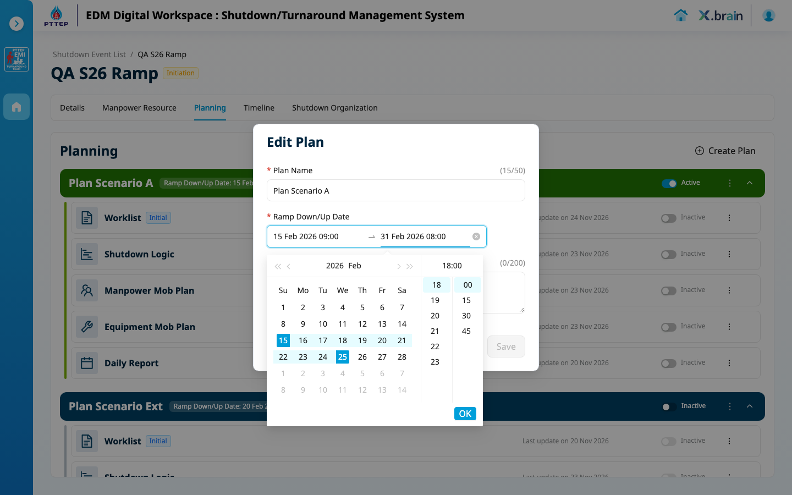
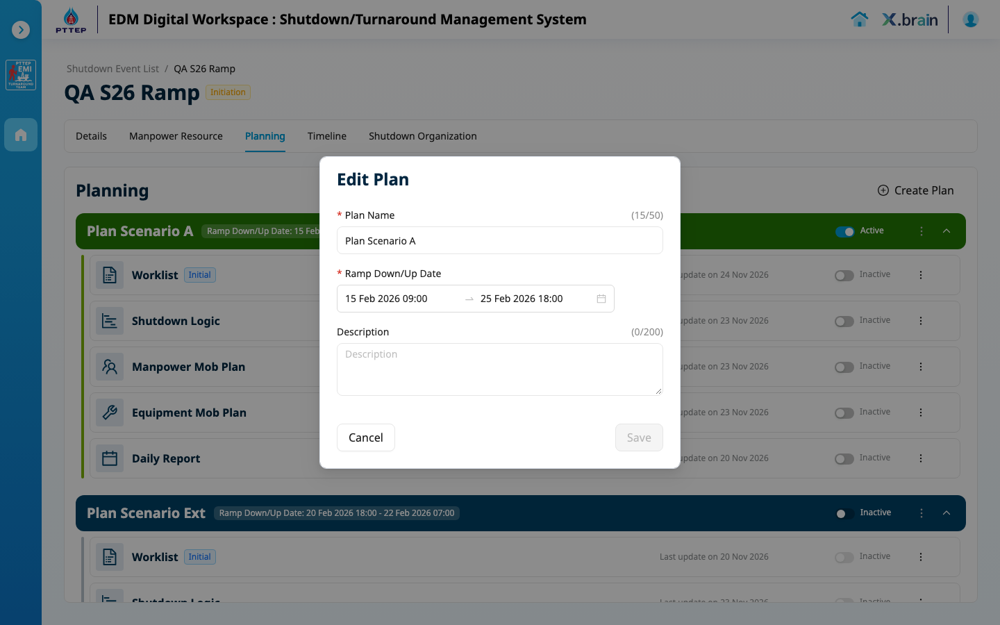
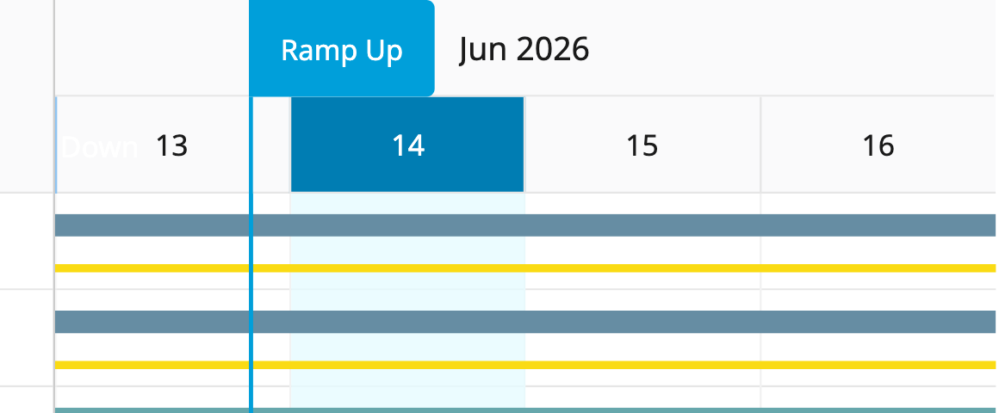
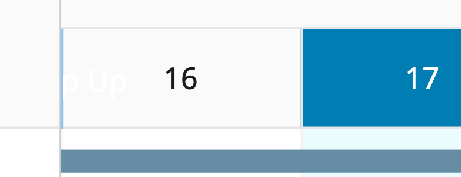
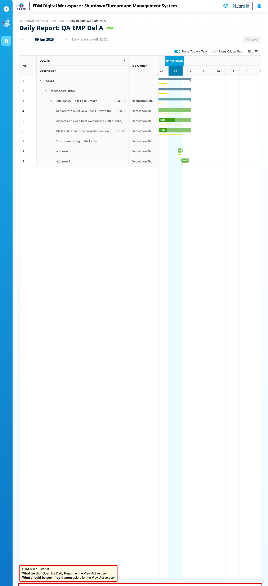
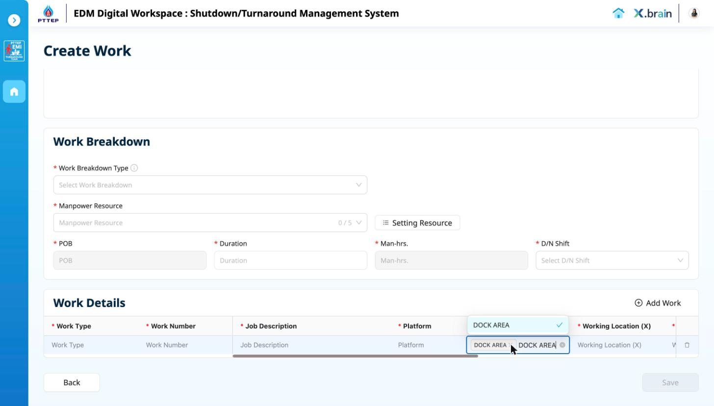
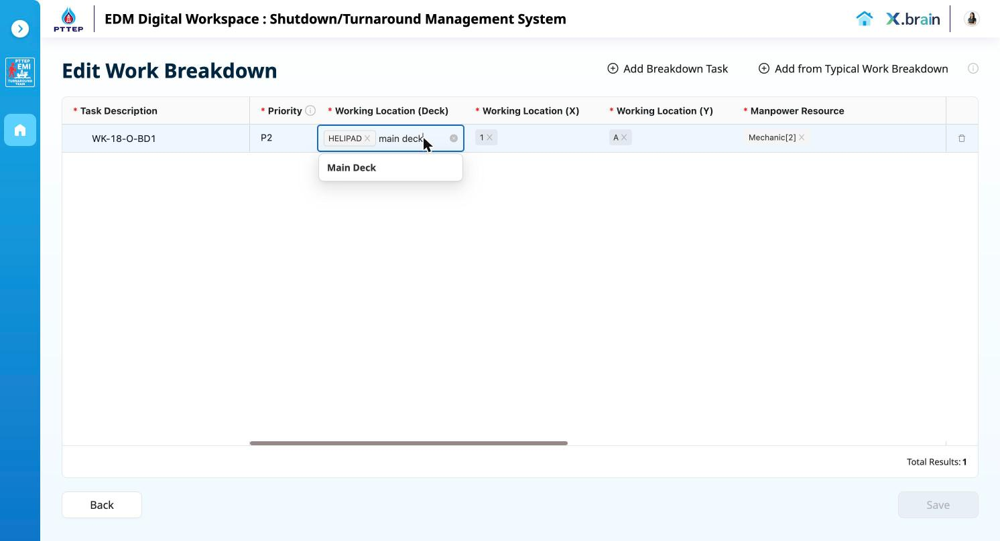
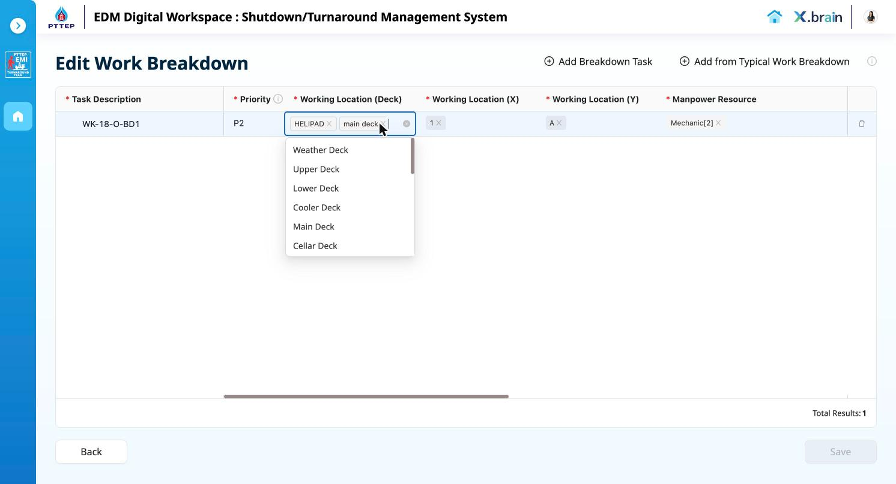

# Sprint 26 – All questions for BA and Dev (24–25 Nov 2026)

# Part 1 – Open questions (please answer these)

All questions still waiting for an answer, for the cards In Testing. QA build of 24 Nov 2026.
⭐ = changes an Expected Result or decides whether a defect is logged. Each question says what QA does with each answer.

| Card | Questions | Pictures |
|---|---|---|
| ETM-8042 Planning – Ramp Down & Up date | Q12 | 8 |
| ETM-8049 Worklist – Working Location columns | Q33 (defect ETM-9225), Q34 | 3 |
| ETM-8392 Daily Report – Ramp lines on Gantt | R3-Q1, R3-Q2 | 2 |
| ETM-8394 Import Work status | R4-1, R4-2, R4-3, R5-1, R5-2, R5-3 (defect ETM-9233) | – |
| ETM-8521 Shutdown Logic – copy & paste | R3-1, R3-2 | – |
| ETM-7343 Daily Report – Actual (%) font color | Q5 | – |
| ETM-8003 Daily Report – S-Curve colors | R3-Q1 | 1 |
| ETM-8034 Shutdown Logic – row / cell highlight | R4-1 (Highlight Cell) | – |
| ETM-8415 Shutdown Logic – move as a block | Q1 (linked Tests) | – |

---

## ETM-8042 – Q12 ⭐ Invalid date in the Ramp Down/Up Date picker (Test ETM-8851, AC 1.2)

Where: QA, event "QA S26 Ramp" > Planning tab > Plan Card "Plan Scenario A" > three-dot > Edit Plan. Current value `15 Feb 2026 09:00 -> 25 Feb 2026 18:00`. Turnaround Manager, nothing saved.

Your answer to Q11 (24 Nov): the picker clears the invalid part and Save is disabled. On QA now:

| Case | Input | Expected (Q11 / AC 1.2) | Actual on QA |
|---|---|---|---|
| 1 | Paste `31 Feb 2026 08:00` into Start | Start cleared, Save disabled | Invalid text shown, no red border, no message, Save disabled. After leaving: Start goes back to `15 Feb 2026 09:00` (on the next click, not on Tab) |
| 2 | Paste `31 Feb 2026 08:00` into End | End cleared, Save disabled | Same; End goes back to `25 Feb 2026 18:00` on Tab |
| 3 | Paste `2026-02-08 08:00` into End | End cleared, Save disabled | Same as case 2 |
| 4 | Type `31 Feb 2026 08:00` into End | End cleared, Save disabled | Same as case 2 |

Nothing invalid is saved in any case; the difference is only "cleared" vs "previous value put back".

**Question:** Which is correct?
- (a) Clear the part and disable Save (Q11, AC 1.2): the current app is a **defect**.
- (b) Put back the previous valid value: QA updates AC 1.2 reference and ETM-8851, no defect.

Also: should Start and End behave the same? (Start puts the value back only on the next click, End already on Tab.)

| Case | a = right after the input | b = after leaving the field |
|---|---|---|
| 1 (Start) |  |  |
| 2 (End, paste) |  |  |
| 3 (End, other format) |  |  |
| 4 (End, typed) |  |  |

---

## ETM-8049 – Q33 ⭐ Old lower-case Deck value is not converted (defect ETM-9225, Test ETM-8793, TC-020)

Event NN TEST QA, Plan "QA ETM-8049 Old", work `WK-18-O`, Work Breakdown `WK-18-O-BD1` (Deck = `HELIPAD, main deck`).
- Edit Breakdown, remove the tag `main deck`, type `main deck`, press Enter: the tag stays `main deck` (lower case), although the suggestion list shows `Main Deck`.
- Typing `mAiN dEcK` on the same cell gives `Main Deck`. Only the spelling already stored on the event is not converted.

**How the data was made:** the screen now converts every new entry to the Master Data spelling, so it cannot make a lower-case `main deck` any more. QA set `main deck` directly in the QA database to stand for data saved before this change (AC 6.4: existing values are not converted, no migration). Defect ETM-9225 is already logged, so we need your answer to keep it open or close it.

**Questions:**
1. Do values that differ from Master Data only by letter case (e.g. `main deck` for `Main Deck`) really exist in production data saved before this change? (yes / no)
2. If yes: must a new entry `main deck` still convert to `Main Deck`, even when the event already holds the old value `main deck`? (AC 6.1 / 6.3 vs AC 6.4)

- 1 = yes and 2 = yes: ETM-9225 stays open.
- 1 = no: QA closes ETM-9225 as "data not reachable from UI" and removes that step from TC-020.
- 2 = no: QA closes ETM-9225 and changes the expected result of TC-020.

| Typed `main deck`, suggestion shows `Main Deck` | After Enter: stays `main deck` |
|---|---|
|  |  |

---

## ETM-8049 – Q34 ⭐ Two Deck values that differ only by letter case in one cell (Test ETM-8788, TC-015)

Create Work, one Deck cell: after the tag `Dock Area` (or `DOCK AREA`) is in the cell, typing `DOCK AREA` (or `dock area`) shows the existing tag as already selected (a tick in the list), and pressing Enter adds nothing. So one cell cannot hold two free-text values that differ only by letter case.

Your answer to Q32 says Create Work accepts several Deck values in one cell, and AC 6.2 says free text is saved exactly as entered. TC-015 expects the cell `Main Deck, Cellar Deck, Dock Area, DOCK AREA`. Import shows the same rule (`Helipad,helipad` is rejected, defect ETM-9223).

**Question:** Which is correct for Create Work and Edit Work Breakdown?
- (a) The cell may hold `Dock Area` and `DOCK AREA` together: this is a defect like ETM-9223.
- (b) Values that differ only by letter case are duplicates inside one cell: QA changes TC-015.


---

## ETM-8392 – Round 3 (AC-4 Export PDF)

Data: Event ART PSD, Plan **QA 8392 Snap C** (snapshot Ramp Down 11 Jun 2026 08:00, Ramp Up 13 Jun 2026 20:00). Export: `Daily Plan` + `Focus Timeframe` (window D-1 00:00 to D+2 23:59, DEC-061).

### R3-Q1 ⭐ Part of a Ramp badge shows in the PDF when its line is outside the Focus window (Tests ETM-8690 step 7, ETM-8692 step 4)

The lines themselves are correct in every PDF we checked. But where a line is **outside** the window, a small piece of its badge text is still drawn in the Gantt header:

| PDF (day D) | Window | Line outside | What shows |
|---|---|---|---|
| 14 Jun 2026 | 13–16 Jun | Ramp Down (11 Jun) | faint white text "Down" left of the "13" column |
| 17 Jun 2026 | 16–19 Jun | Ramp Up (13 Jun) and Ramp Down | faint white text "p Up" at the left edge of the "16" column |

The text is also in the PDF text layer (not an image artefact). On screen the badges look correct.

**Question:** When a Ramp line is outside the Focus window, should the PDF show **nothing** of that line (no line and no badge text)? If yes, QA logs a defect. If a cut badge at the edge is acceptable, QA passes these steps.

14 Jun PDF:



17 Jun PDF:



### R3-Q2 (minor) Last column and edge badge cut by the page edge

- In the Focus PDFs, the last day column (D+2) is cut by the right page edge.
- In the 11 Jun PDF (window 10–13 Jun) the Ramp Up line on 13 Jun (last day, inside per DEC-061) is drawn, but its badge shows only "R".

**Question:** Is it acceptable that the D+2 column and a badge on that day are partly cut, or should the whole D+2 day and its badge fit on the page?

---

## ETM-8394 – Round 4 (Import Work Status / Breakdown Status)

19 Tests: 13 passed, 4 failed, 2 not run (need a frozen Worklist). Two failures depend on your answer.

### R4-1 ⭐ A breakdown UUID from a deleted Work, used under another Work (Test ETM-8766)

Setup: Work `Y1` (2 breakdowns) and Work `Y2` (1 breakdown). `Y1` is deleted through import (`Action = Delete`).
File: `Y2` Work row with `Action = Revise`, plus one `Work Breakdown` row under `Y2` with `Action = Revise` and the UUID of a breakdown of the deleted `Y1`.
- **App shows:** "The work breakdown with the entered UUID is already associated with another work in the system." `Import` is disabled.
- **Test expects:** "The UUID you entered is not exist in the system." (AC 3.4), because the breakdown was deleted with `Y1`.

**Question:** Which message is correct? The row is rejected in both cases; only the message differs.
QA assumes AC 3.4 wins. If "already associated" is accepted, QA changes ETM-8766 and logs no defect.

### R4-2 ⭐ Delete a Work and its breakdowns in one file (Test ETM-8767)

File: `Z2` Work row with `Action = Delete` and one `Work Breakdown` row of `Z2` with `Action = Delete`. Import is accepted and confirmed.
- **Result:** Work `Z2` is soft deleted (gone from the Worklist). Its breakdown row is still in the database with no delete flag.
- **Template rules say:** deleting a Work is a soft delete together with its breakdowns.

**Question:** Should the breakdowns of a deleted Work also be marked deleted, or is it enough that the parent Work is deleted?
QA assumes they must be marked deleted too (then QA logs a defect). If not, QA changes ETM-8767 to check only that the Work is deleted and its breakdowns no longer show.

### R4-3 (no answer needed if R4-2 is "defect")

With the breakdown still in the database, a later Revise with its UUID could give the "already associated" message of R4-1 instead of "not exist". R4-1 and R4-2 may have the same cause.

### Round 5 – defect ETM-9233 "Exported Worklist cannot be imported back unchanged" (Test ETM-8755)

On QA (Worklist "Wide Plan B - NN", Turnaround Manager):
- `Export Worklist` gives a file whose sheet `Worklist_Data` has the `Action` column (C) blank on all 306 data rows (84 Work, 222 Work Breakdown). `UUID` is filled.
- Uploading that file unchanged gives "Data Validation Failed. 308 data validation errors were found in the file." Every row shows "This field is mandatory." on `Action`. `Confirm` is disabled.
- The file holds the whole Worklist, even when the list on screen was filtered with the search box.

**R5-1 ⭐ What should `Action` be in an exported file?** AC 4 says "export then import again keeps each Work's status". Today that is not possible without editing the file.
- (a) The export fills `Action = Revise` on every row.
- (b) The export leaves `Action` blank, and the import treats a blank `Action` on a row **with a UUID** as `Revise`.
- (c) Blank is correct and the user must fill `Action` first; AC 4 then needs a note.

QA assumes (a) or (b), so ETM-9233 stays a defect. If (c), QA closes ETM-9233 as "not a defect" and changes ETM-8755 step 3.

**R5-2 ⭐ Should the export follow the Worklist search / column filters?** Today it ignores them. QA assumes the whole Worklist is correct (not a defect). If it must follow the filter, please say which filters count.

**R5-3 (only if R5-1 is (b))** An unchanged row then imports with no error and no change, and `Updated By` / `Updated Date` do not change. Please confirm.

---

## ETM-8521 – Round 3 (copy & paste in the Gantt table)

Turnaround Manager account.

### R3-1 ⭐ Copy of two cells that are not next to each other (Test ETM-8737, steps 6–7)

1. Selected the Description cell of row 1, then Ctrl+click on the Duration cell of row 2 (not next to each other; both show as selected).
2. Ctrl+C.
3. Clicked the Description cell of another row and Ctrl+V.

- **App:** the clipboard holds the two values in **one column** (`Pump overhaul A`, then `12`). After paste, target row 1 Description = `Pump overhaul A` (OK), but `12` goes to the **Description of target row 2**; Duration of row 2 is not changed.
- **Test expects:** the layout is kept: row 1 Description = `Pump overhaul A`, row 2 Duration = `12`, the two skipped cells stay blank.

**Question:** Which is correct?
- (a) Layout must be kept: current behaviour is a defect.
- (b) Non-adjacent cells are packed into one column: QA changes step 7 of ETM-8737.
- (c) Copying non-adjacent cells is not supported: QA removes steps 6–7.

### R3-2 ⭐ Finish-to-Start after pasting a new Start date (Test ETM-8743, step 6)

Task B depends on task A (Finish to Start, no lag), same Work. Pasted a new Start date (A's Start + 1 day) into A.
- Before (step 5): A ends `02 Jun 2026, 20:15`, B starts `02 Jun 2026, 20:15`.
- After (step 6): A ends `03 Jun 2026, 19:45`, B starts `03 Jun 2026, 20:00`.
- B's calendar has working time between 19:45 and 20:00, so B could start at 19:45.

**Question:** Should B start exactly when A ends (19:45)?
- (a) Yes: the 15-minute gap is a defect.
- (b) No: the gap is expected (please give the rule: rounding, a constraint kept on B, a shift start…); QA changes the Expected Result of step 6.

---

## ETM-7343 – Q5 ⭐ Job Owner on a new Event's Active Plan (Test ETM-8678)

On QA, the Job Owner test account opens the Daily Report of the Active Plan "QA ETM-7343 Colors" (Event "QA ETM-7343", the only Plan, Active) and gets "Access Denied: If you need access to the Application, please send a request with your details." The Turnaround Manager opens the same page fine.

**Questions:**
- Must a Job Owner be added to the Event (organization / member) or be the Job Owner of a work in the Plan before they can see its Active Daily Report?
- If yes, how is that done on the screen, so QA can set it up?
- If no, the Job Owner should see the table, and this is a defect.

---

## ETM-8003 – R3-Q1 ⭐ S-Curve filter button is disabled for the Job Owner (Tests ETM-8808, ETM-8809)

- The user is the Job Owner (permission "View Active Daily Report Item"), on the Daily Report of an Active plan: Event ART PSD, Plan "QA EMP Del A".
- The S-Curve – Cumulative Progress card shows the chart with the correct colors (Plan blue #1677FF, Actual orange #FA8C16), the same as for the Turnaround Manager.
- The filter button at the top of the S-Curve card is **disabled**, so the Job Owner cannot open the Filter Panel to change Scale (Day / Week / Month), Show Plan(%) or Show Actual(%) (Show All / Show Only Today).
- The Turnaround Manager ("View All Daily Report Item") has the same button enabled on the same page.

**Question:** Is the S-Curve filter meant to be disabled for a view-only user (Job Owner)?
- **Yes:** expected behaviour; ETM-8808 / ETM-8809 are tested with the Turnaround Manager only.
- **No:** the Job Owner should be able to use the Filter Panel (it only changes the view and saves nothing). QA logs a defect against the Story that owns the S-Curve filter (ETM-4127?). Please confirm which Story that is.



---

## ETM-8034 – R4-1 ⭐ Highlight Cell is not in the AC

AC 1.2 (edited 24 Nov 14:23) now says No Color + 12 colours (13 options): this matches ETM-8856 and the script. Thank you.

The build of 24 Nov and the behaviour table the team shared say: a right-click on a cell (no row selected) shows **Highlight Cell** and colours only the selected cell(s); **Highlight Row** shows only after a double-click on the No. cell selects the whole row. Shift + Click / Shift + Double Click select several cells / rows. AC 1.1 still says "Right-clicking a row ... Highlight Row", and AC 2 / AC 3 speak of the whole row only.

**Please add to AC 1.1, AC 2 and AC 3:**
- (a) how to select a row (double-click No.);
- (b) Highlight Cell / Change Text Color on one or several cells;
- (c) whether a cell colour is saved, undone, duplicated, copied and exported like a row colour;
- (d) the Delete option in this menu (is it the existing Delete Work / Delete Work Breakdown?).

Until then QA tests Highlight Row through a selected row, and has no Test for Highlight Cell.

---

## ETM-8415 – Q1 ⭐ The 263 linked Tests do not test this Story

ETM-8415 ("Work Header and Work Dependencies move as a block") has 263 Tests linked with "is tested by" (ETM-8945 to ETM-9217), all created on 24 Nov 2026 16:07–17:01 in one bulk import, all Open.
- They are a whole-page Shutdown Logic regression suite: page load, URL, JO view-only, cell edit, Start Date, drag/resize, Manual Adjust, hard-link drag, red cells, save blocking. 263 unique titles, no duplicates.
- **None** of them is about this Story: Work Header as Predecessor/Successor, moving as a block, Block Start/End, nested blocks, a constraint on a block. AC 1–12 of ETM-8415 have no Test.
- The suite fits ETM-8905 ("Shutdown Logic – code restructuring, no behavior change", AC 4: full regression) much better. ETM-8905 has no Tests linked.

**Questions:**
1. Were these 263 Tests meant for ETM-8905 (regression after the refactor) rather than ETM-8415? If yes, QA will move the links to ETM-8905 (with your OK) and run them there.
2. For ETM-8415, may QA write its own Tests from AC 1–12 (block move), or is there another set planned?

---

Thank you.


# Part 2 – Full history of all questions per card (for reference)

Every question file QA wrote for each card, oldest round first, as written. Many of these are already answered; answers are kept in each card's `ba-answers.md`.


---

## ETM-7343

### Source: `ETM-7343/questions-for-BA.md`

### ETM-7343 Questions for BA: Daily Report - Actual (%) Font Color Based on Plan Progress

Test cases (15) are written from AC 1 to 5 and are already in Xray. The three questions below change the Expected Result of cases that are not written yet, so we need answers before adding them.

#### Q1. Which value is compared: shown or stored?
Plan (%) and Actual (%) can be shown rounded (the PDF template shows whole numbers, the Shutdown Logic schedule shows 1 decimal).
Example: stored Actual 33.4% and stored Plan 33.0%, both shown as `33%`.
- Option A: compare the shown values -> 33 = 33 -> green.
- Option B: compare the stored values -> 33.4 > 33.0 -> green. (Reverse example: Actual 32.6 and Plan 33.0 both shown as `33%`: A gives green, B gives red.)
Which one is correct for AC 1.1 and 1.2?

#### Q2. Empty or `-` value
If Plan (%) or Actual (%) has no value (empty or `-`), which font color should the Actual (%) cell show: red, green, black, or no rule?

#### Q3. PDF export: background and Total row
The Daily Report export template (Activity Group Progress table) shows a green cell background when a value is 100% and no color on the Total row. AC 5 says the PDF shows the same Actual (%) font colors as the screen.
- Is the green cell background at 100% still wanted in the PDF, or only the font colors in AC 1?
- Does the Total row follow the font color rules, or stay in the default color?

#### Q4 (for the team, not BA). Execution date control
Which control on the Daily Report page changes the execution date (dropdown, date picker, arrows)? A screenshot is enough. Needed to write the exact steps of the date-switching cases.

#### Q5 (24 Nov 2026). Job Owner on a new Event's Active Plan
On QA, the Job Owner test account opens the Daily Report of the Active Plan "QA ETM-7343 Colors" (Event "QA ETM-7343", the only Plan, Active) and gets "Access Denied: If you need access to the Application, please send a request with your details." The TA Manager opens the same page fine.
- Must a Job Owner be added to the Event (organization / member) or be the Job Owner of a work in the Plan before they can see its Active Daily Report?
- If yes, how is that done on the screen, so QA can set it up?
- If no, the Job Owner should see the table, and this is a defect.


---

## ETM-8003

### Source: `ETM-8003/questions-for-BA.md`

### ETM-8003 Questions for BA (S-Curve Colors: Blue Plan, Orange Actual)

Test cases are drafted (8 cases) and on hold. These answers decide whether cases are added or made exact.

1. **Exact colors.** What are the hex values or Nualta tokens for the blue (Plan) and the orange (Actual)? Figma shows the colors but not the values. Without them QA can only check "not yellow" and "not green".
2. **Word export.** The Word export (Daily Report export template, Section B) also has an S-Curve (Plan yellow, Actual olive green today). AC-4 names only Export PDF. Should the Word export change too?
3. **Export PDF line style.** AC-4 says "same colors". Should the Plan line stay dashed and the Actual line solid in the PDF? Are data points and data labels drawn in the PDF as on the screen?
4. **Filter icon on the S-Curve card.** What does it do (hide Plan or Actual?) and should the remaining line keep its new color?
5. **No permission.** What does a user with neither View All nor View Active Daily Report Item see (page hidden, message)?
6. **Earlier days.** How does a user open the Daily Report of an earlier day (date header arrows)? Should it show the new colors too?

### Source: `ETM-8003/questions-for-BA-round2.md`

### ETM-8003 Questions for BA, round 2 (found while running the tests on QA, 23 Nov 2026)

The S-Curve is a single `<canvas>`, so QA reads colors from its pixels. All four new colors are drawn on QA (`#1677FF`, `#FA8C16`, `#1D39C4`, `#D46B08`). These questions come from the Filter Panel and the test data.

1. **Show Only Today changes nothing on the chart.** In the Daily Report of plan `AWP03 FSD Plan A` (Scale Day), switching Show Plan(%) or Show Actual(%) between `Show All` and `Show Only Today` leaves the line exactly the same. Plan stays about 808 px wide with the same pixel count, Actual stays about 131 px wide. Changing Scale to Week does change the chart. Your answer to round 1 says `Show Only Today` reduces the line to the single point of the active execution date. Is that still the expected behavior? If yes, is there a condition (for example the report date has no Plan or Actual point, or the panel needs another action) that explains why QA sees the full line?
2. **Default of the Filter Panel.** When the panel opens, QA sees Scale `Day`, Show Plan(%) `Show Only Today` and Show Actual(%) `Show Only Today` already selected, but the chart shows the full lines. ETM-4127 AC 6 names `Show Only Today` as the default while the Reset button restores `Show All`. Which one is the real default, and should the chart already show only one point when the page opens?
3. **Test data.** The values in the Figma sample (Plan labels 0%, 0%, 39.21%, 77.44%, 100%, 100% and Actual 0%, 0%, 42.66%) are not the values of the Daily Report we use on QA (the Progress Summary shows groups TEST, TEST 2, TEST 4 with whole-number Plan and Actual percentages). Which plan and report date should QA use to check the label values? Or should we only check colors and not label values?
4. **View Active Daily Report Item.** A user with only `View Active Daily Report Item` can open the Daily Report `QA EMP Dup B`, where the S-Curve card shows its title but no chart is drawn. Is a plan without S-Curve data expected to show an empty card, and which plan should QA use to compare the colors for this role?

### Source: `ETM-8003/questions-for-BA-round3.md`

### ETM-8003 - Questions for BA (round 3, 24 Nov 2026)

Story: ETM-8003 Daily Report - S-Curve Colors (Blue Plan, Orange Actual). Environment: QA.

#### Q1. S-Curve filter button is disabled for the Job Owner

**What we see**
- The user is the Job Owner (permission "View Active Daily Report Item").
- They open the Daily Report of an Active plan: Event ART PSD, Plan "QA EMP Del A", status Active.
- The S-Curve - Cumulative Progress card shows the chart. The colors are correct: Plan blue #1677FF and Actual orange #FA8C16, the same as for the Turnaround Manager.
- The filter button at the top of the S-Curve card is **disabled**. The Job Owner cannot open the Filter Panel, so they cannot change:
  - Scale: Day / Week / Month
  - Show Plan(%): Show All / Show Only Today
  - Show Actual(%): Show All / Show Only Today
- The Turnaround Manager ("View All Daily Report Item") has the same button enabled on the same page.

**Question**
Is the S-Curve filter meant to be disabled for a view-only user (Job Owner)?
- If **yes**: we keep this as expected behavior. ETM-8808 / ETM-8809 (Filter Panel options) will be tested with the Turnaround Manager only.
- If **no**: the Job Owner should be able to use the Filter Panel, because it only changes the view and saves nothing. We will log a defect against the Story that owns the S-Curve filter (ETM-4127?). Please confirm which Story that is.

Evidence: `ep-etm-fe-qa/output/evidence/ETM-8807/step3_colors_active.png` (Job Owner view). Run `2026-11-24_221700_ETM-8003`.


---

## ETM-8034

### Source: `ETM-8034/questions-for-BA.en.md`

### ETM-8034 Questions for BA (before writing test cases)

Story: [Improvement] Shutdown Logic - Row Highlight and Text Color in Gantt Table
Status: Ready For Development · No comments · ⭐ = directly affects an Expected Result, please answer first

#### Context menu and palette

1. (Closed: 13 cells = No Color + 12 colors, confirmed by the tester; order as in the table at the end.) One small point left: do the color cells show a tooltip or a name on hover? If yes, please give the text.
2. ⭐ If several rows are selected (multi-select) and the user right-clicks, is the color applied to all selected rows or only to the right-clicked row?
3. In Figma, some cells have a blue outline (e.g. No Color and the pink one in Change Text Color). Is that hover or "current color" (selected)? Does the submenu show the row's current color? What happens when the user picks the color the row already has?
4. ⭐ Users without permission (AC 1.5): do the existing menu options still appear as usual? If there are no other options, what happens on right-click (empty menu, no menu)?

#### Coloring scope (AC 2, 3)

5. ⭐ Which columns does "whole table row" cover (including frozen/fixed columns, the Gantt bar area on the right, the expand/collapse button, icons in cells)? Does Text Color also change icons and links in the row?
6. ⭐ If a color is applied on a Platform or Work Header row, do the child rows (Work, Work Breakdown) inherit it, or only the selected row? If a child already has its own color, which one wins?
7. Does the color follow the row when it is collapsed, expanded, moved, or copy-pasted? (Copy & Paste is covered in ETM-8035.)
8. Does a new row added or inserted from a colored row get the source row's color or the default?

#### Condition colors (AC 4)

9. ⭐ What exactly is the "layer that mixes with the highlight color" (opacity value, which color is on top)? We need the values from Figma node 163-807247 to write Expected Results for a disabled cell and a validation error.
10. When Text Color conflicts with a condition text color (e.g. red error text), which one wins? Is there a rule to prevent low contrast (e.g. yellow text on a yellow background)?
11. How do hover / selected / focus states of a row layer over the highlight color?

#### Saving (AC 5)

12. ⭐ If the user changes a color and leaves the page without clicking Save, is there an unsaved-changes warning? If not, the change is lost, correct?
13. If two users change the color of the same row at the same time, does the last Save win? Is there a conflict message?
14. Does changing only a color (no other edit) enable the Save button and the "has unsaved changes" indicator, the same as a normal edit?
15. Which Shutdown Logic version/plan are the colors tied to? If a version or copy of the Shutdown Logic is created, are the colors copied too?

#### Undo / Redo (AC 6)

16. ⭐ When several rows are colored at once, is that one Undo step or one per row? Is it in the same history as other edits? After Save, can Undo still revert the color?

#### Export PDF (AC 7)

17. ⭐ Does the PDF show the same highlight and text colors as the screen, including the mixed condition colors? If the user changed a color but did not Save, does the PDF use the saved color or the one on screen? (Black-and-white printing is out of scope unless you say otherwise.)

#### Other

18. Is existing data without colors treated as "No Color" (default)? Does the BE store the fields `Highlight Color` and `Text Color` as named in Data Source? How is "No Color" stored (null or a value)?
19. ETM-8035 (Done, "Gantt Table Enhancements (Row Highlight, ...)") is linked as "relates to" this Story. Did it already deliver the same feature? What is the difference in scope, and does ETM-8034 replace or extend it?

#### Palettes received (from the Color Code images)

| # | Highlight Row (light) | Change Text Color (strong) |
|---|---|---|
| 1 | #D6E4FF | #1D39C4 |
| 2 | #BAE0FF | #1677FF |
| 3 | #B5F5EC | #08979C |
| 4 | #D9F7BE | #52C41A |
| 5 | #EBF5BA | #81A827 |
| 6 | #FFFB8F | #D4B106 |
| 7 | #FFE58F | #D48806 |
| 8 | #FFE7BA | #FA8C16 |
| 9 | #FFD8BF | #FA541C |
| 10 | #FFCCC7 | #F5222D |
| 11 | #FFD6E7 | #EB2F96 |
| 12 | #EFDBFF | #722ED1 |

Note: confirmed from the Figma menu screenshots: Change Text Color opens the strong palette, Highlight Row opens the light palette. Both options sit above "Delete Work" (matches AC 1.1). Each submenu has No Color (the 13th cell) + 12 colors = 13 cells. The AC 1.2 wording "No Color followed by 13 colors" is treated as loose wording (read as 13 cells including No Color).

### Source: `ETM-8034/questions-for-BA-remaining.en.md`

### ETM-8034 Remaining questions for BA / ux (after the first round of answers)

Story: [Improvement] Shutdown Logic - Row Highlight and Text Color in Gantt Table
Already answered and used in the test cases: see ba-answers.md. These are only the points that are still open. Each one says which test case is affected.

#### Blocks an exact Expected Result

1. Permission name: which permission decides whether the two options show? The Story says "Edit Shutdown Logic Table and Visualization"; the Roles & Permissions picture shows "Edit Plan" under Shutdown Timeline (Turnaround Manager yes, Job Owner no). (No-permission cases)
2. Hover, selected and focus look of a highlighted row: how do they layer over the highlight color? (waiting for the ux picture; no test case yet)
3. Condition color mix (disabled cell, validation error over a highlighted row): opacity and which color is on top. (waiting for the ux picture; the condition-color cases only check that the color is still visible)
4. Unsaved-changes modal: exact text and button names, and what each button does to the unsaved color.
5. After a color-only change and Save: which success message appears (same as other Saves)?

#### Blocks the way to run a step

6. Gantt table: how does a user move a row (drag, buttons, other)? (color stays after move)
7. Gantt table: how does a user copy and paste a row (action, which level can be pasted where)? (copy/paste does not carry the color)
8. Names of the existing options in the row context menu of the other levels (Platform, Work Header, Work Breakdown). Figma shows only the Work row menu: Highlight Row, Change Text Color, a line, then `Delete Work`.
9. How to produce a disabled cell and a validation error cell in the Gantt table (which field, which action)? Today only the red resource cell from "Delete Resource" is known.
10. Keyboard shortcut for Undo and Redo on this page (the buttons are at the top left of the Gantt toolbar).

#### Minor

11. Does a color cell in the submenu show a tooltip or a name on hover?
12. Does choosing the same color again create an extra Undo step?

#### Suggestions (not in the Story, no test case unless you say yes)

- S1: a role without the permission calls the save API with a color: should it be rejected?
- S2: a colored row is deleted and Undo restores it: is the color restored?
- S3: colors while Filter Panel or column filters are active.
- S4: when another user saves later and replaces a color, should the first user be told? (answer today: last Save wins, no message)

### Source: `ETM-8034/questions-for-BA-round3.en.md`

### ETM-8034 Questions for BA, round 3 (2026-11-24)

Story: [Improvement] Shutdown Logic - Row Highlight and Text Color in Gantt Table (status In Development).
Found in the Sprint 26 check of the test cases against the live AC. Each question says which test case waits on it.

1. AC 1.2 says the submenu shows "No Color (⊘), followed by 13 colors". Your earlier answer, the Figma menu and the palette table give No Color + 12 colours (13 cells in all). Please correct AC 1.2 to "No Color followed by 12 colors", or tell us the 13th colour and its hex. (ETM-8856 steps 2, 4, 6, 8 test No Color + 12.)
2. Undo history: after a user saves a change in the Work Setting modal (Edit Work) on the Shutdown Logic page, does Undo on the page revert that modal change, in order with the colour changes? Neither the AC nor an earlier answer says so. (ETM-8865 step 24 expects yes; if no, we remove that step.)
3. AC 8.2 Copy & Paste: the build copies a row by double-clicking its No. cell and pressing Ctrl+C, and pastes with a double-click on the No. cell of the target row and Ctrl+V. Is this the Copy & Paste AC 8.2 means (cell values only, no colour), or is there another copy action, for example a menu item? (ETM-8861 steps 1-4.)

### Source: `ETM-8034/questions-for-BA-round4.en.md`

### ETM-8034 questions for BA, round 4 (2026-11-24) — ON HOLD (user 2026-11-24: Highlight Cell is intended, wait; do not send)

AC 1.2 (edited 24 Nov 14:23) now says No Color + 12 colours (13 options): this matches ETM-8856 and the script. Thank you.

1. **Highlight Cell is not in the AC.** The build of 24 Nov (stms-fe 73dfde33) and the behaviour table the team shared say: a right-click on a cell (no row selected) shows **Highlight Cell** and colours only the selected cell(s); **Highlight Row** shows only after a double-click on the No. cell selects the whole row (Select Row + Right Click). Shift + Click / Shift + Double Click select several cells / rows. AC 1.1 still says "Right-clicking a row ... Highlight Row", and AC 2 / AC 3 speak of the whole row only.
   Please add to AC 1.1, AC 2 and AC 3: (a) how to select a row (double-click No.), (b) Highlight Cell / Change Text Color on one or several cells, (c) whether a cell colour is saved, undone, duplicated, copied and exported like a row colour, (d) the Delete option in this menu (is it the existing Delete Work / Delete Work Breakdown?).
   Until then QA tests Highlight Row through a selected row, and has no Test for Highlight Cell.


---

## ETM-8042

### Source: `ETM-8042/questions-for-BA.md`

### ETM-8042 Questions for BA (round 2: open questions only)

**Story:** [Improvement] Planning - Individual Ramp Down & Up Date
**Status:** In Development. No comments. Description matches the BA file (synced 2026-11-15).
⭐ = affects an Expected Result directly, please answer first.
Test cases are drafted (23). Only the points below are still waiting.

#### Open questions

1. ⭐ Daily Reports created before this release have no snapshot of the Plan's Ramp Down/Up Date (AC 8.2). What do they use: the Plan's current dates, the Shutdown Event's Planned Date, or are they not supported / left unchanged?
2. ⭐ Daily Report PDF (ETM-5277): is Day 1 the Ramp Down date (for example 15 Feb) or the First Execution Date after the 18:00 rule (for example 14 Feb)?
3. Exported Excel and PDF: are the Ramp Down/Up values shown as `DD Mmm YYYY HH:mm` (as on the Plan Card badge) or as date only?
4. ⭐ Create/Edit Plan: if only a Start date or only an End date is picked in the Ramp Down/Up Date range, is `[ Save ]` enabled or disabled, and what happens when it is clicked?
5. ⭐ When Ramp Up is picked earlier than Ramp Down, the picker adjusts the value by itself and shows no error. What exactly is the adjusted value (End set equal to Start, Start set equal to End, or something else), and for the same day with an earlier time?
6. Plan Card badge (AC 4): how does it look on a narrow card or with a long Plan Name (truncate, wrap)?

#### Please confirm (answered by the QA team lead from the Story and Figma, not yet by you)

- Every Shutdown Event has a Planned Date, so existing Plans always get it as their Ramp Down/Up Date (AC 6).
- The Create Plan field is pre-filled with the Planned Date (AC 1.3). Figma shows only the empty state.
- `[ Save ]` is disabled until Plan Name and Ramp Down/Up Date are filled.
- No upper limit on the range length, only the format must stay `DD Mmm YYYY HH:mm`.
- The Extension moves the Plan's Ramp Up Date to the date the user chooses.
- No confirmation or warning when editing the dates, even when Shutdown Logic or Daily Reports exist.
- The Plan Card badge is always shown, with date and time.
- Only a Turnaround Manager can create or edit a Plan; other roles cannot.
- The Optimization Module receives date and time of the Plan's Ramp Down/Up.

#### Suggestions (not in the Story, answer only if useful)

- S1: Can a date be typed or pasted into the picker (for example `31 Feb 2026 08:00`)?
- S2: Do other roles (for example Job Owner) still see the badge on the Plan Card?
- S3: If the Extension updates the Plan but the Daily Report snapshot update fails (or the other way round), what does the user see and what is stored?
- S4: If two users save different Ramp Down/Up values for the same Plan at the same moment, which one wins, and does the other user get a message?

#### Raised during the QA run, 2026-11-20 (answered by BA through the user the same day)
7. (AC-8.2) A Daily Report created while the Plan's worklist has no work opens on the Ramp Down date itself (Ramp Down 15 Feb 2026 09:00 -> first day 15 Feb), not by the 18:00 rule (14 Feb). Is that intended? — BA: yes, correct behaviour.
8. (AC-8.2) In the same case the Daily Report Gantt shows Jan 2026 instead of the snapshot Ramp Down/Up range. Is that intended? — BA: not an issue while there is no work from the worklist.

9. (AC-8.2, ETM-4127 AC 3) Old Daily Report without a snapshot (QA: Export 5000 / "Optimize Pass", event Planned Date 17 Jun 2026 10:00 - 15 Jul 2026 06:00): the Planned S-Curve on screen and in the PDF ends around 12 Apr 2027, the end of the last task, not on the event Planned end 15 Jul 2026. For a report made before ETM-8042, should the Planned S-Curve end on the event Planned end (15 Jul 2026) or on the last task end? Was this already the behaviour before the ETM-8042 release? — open (ETM-4127 AC 3 and ETM-8042 AC 8.2 say the event end day plus extended days; only the before-release behaviour is still unknown) — BA 24 Nov: ends on the last execution day = snapshot Ramp Up + extended days; old report snapshot = Event Planned end; last task end (12 Apr 2027) is a defect.

#### Raised during the QA run, 2026-11-23
10. (AC-8.1, ETM-5492, AC 6 "no upper limit on the range") On a Plan with a 3-year Ramp Down/Up Date (15 Feb 2026 08:00 - 15 Feb 2029 20:15, QA event "QA S26 Ramp", Plan "Plan Scenario Long Name Plan Scenario Long Name 12"), the Shutdown Logic `Export` dialog shows `Excel File` disabled; only `PDF File` can be chosen. On a 10-day Plan (Plan Scenario A, 15 - 25 Feb 2026) `Excel File` is enabled. Is there a maximum timeframe for the Excel export (if yes, what is it, and should the user see a reason)? Or should Excel be available for any Ramp Down/Up range? — answered from existing Stories 24 Nov: no maximum timeframe (ETM-5492), Excel is disabled only while the page has unsaved edits (ETM-3461 AC 1.2). QA treats the disabled card as a defect candidate; no need to send unless the BA disagrees. BA 24 Nov: QA asks Dev why Excel is disabled.

#### Raised by the Sprint 26 TC/script audit, 2026-11-24
11. (AC-3, ETM-8851, your answer S1 of 18 Nov) You wrote that after pasting an invalid date (`31 Feb 2026 08:00`, `2026-02-08 08:00`) the field keeps its previous value. On QA the picker clears that part instead, and Save becomes disabled until a valid date is entered. On 20 Nov the QA team changed ETM-8851 to follow the app, but that was a QA decision, not yours. Which is correct: (a) keep the previous value, which would make the current app a defect, or (b) clear the part and disable Save, which means S1 is updated? — BA 24 Nov: (b), the app is correct, S1 / DEC-052 updated.

#### Raised 2026-11-24 night (ETM-8851 re-check by hand)
12. (AC 1.2, ETM-8851, your answer to Q11) An invalid date typed or pasted into the Ramp Down/Up Date picker.
    Where: QA, event "QA S26 Ramp" > Planning tab > Plan Card "Plan Scenario A" > three-dot > Edit Plan. Current value `15 Feb 2026 09:00 -> 25 Feb 2026 18:00`. Checked 24 Nov 2026, Turnaround Manager, nothing saved.

    | Case | Input | Your Q11 answer / AC 1.2 (expected) | QA app now (actual) |
    |---|---|---|---|
    | 1 | Paste `31 Feb 2026 08:00` into Start | Start is cleared, Save disabled | While typing: invalid text shown, no red border, no message, Save disabled. After leaving the field: Start goes back to `15 Feb 2026 09:00` (on the next click, not on Tab) |
    | 2 | Paste `31 Feb 2026 08:00` into End | End is cleared, Save disabled | Same; End goes back to `25 Feb 2026 18:00` on Tab |
    | 3 | Paste `2026-02-08 08:00` into End | End is cleared, Save disabled | Same as case 2 |
    | 4 | Type `31 Feb 2026 08:00` into End | End is cleared, Save disabled | Same as case 2 |

    In every case nothing invalid is saved; the difference is only "cleared" vs "previous value put back".
    Pictures (full screen, 8 files): case1-a-before-leave … case4-b-after-leave (a = right after the input, b = after leaving the field). Save is disabled in all of them; no red border or message.

    Which is correct?
    (a) Clear the part and disable Save (Q11, AC 1.2): the current app is a **defect**.
    (b) Put back the previous valid value: AC 1.2 and ETM-8851 are updated, no defect.
    Also: should Start and End behave the same (Start puts the value back only on the next click, End already on Tab)?


---

## ETM-8049

### Source: `ETM-8049/questions-for-BA.en.md`

### ETM-8049 Questions for BA (before writing test cases)

Story: [Improvement] View Worklist Table - Working Location Columns
Source: analyst.md (22 questions). Items marked ⭐ change an Expected Result directly and should be answered first.

#### Master Data and sort order

1. ⭐ What are the Master Data values for Deck? (The Story only gives X = 0-9, N/A and Y = A-J, N/A as "e.g.".) Is the sort order the sheet row order or alphabetical? Is "N/A" always last?
2. Is the X and Y order 0-9 / A-J followed by N/A, or the order in the Master Data sheet? Does the same rule apply to the filter option order (AC 3.4)?

#### Column Customization

3. ⭐ What is "Reset"? Which button, and where in Column Customization? Does it ask for confirmation? Does it restore both order and visibility, so Deck, X and Y go back to hidden and between Department and Manpower Resource?
4. If a saved layout has Department hidden (unchecked), where do Deck, X and Y go? Are they still placed next to the hidden Department position?

#### Filter and cell display

5. ⭐ `Main Deck` and `main deck` are separate options (AC 3.6). If the user selects only `main deck`, should a work that has only `Main Deck` stay hidden (case-sensitive matching)? Is the filter search box case-insensitive?
6. A work holds both `Main Deck` and `main deck` (from different Work Breakdowns). In what order are they shown in the cell (how does localeCompare 'en' numeric treat letter case)?
7. Is a Deck value that itself contains ", " allowed? If yes, how are the cell and the filter options split? Is there any comma validation?
8. Does the ellipsis depend only on column width, or is there a minimum column width? Is the hover tooltip the standard grid tooltip showing the full ", "-joined text?

#### Length and validation

9. ⭐ Where is the 30-character limit per value validated (input field, Excel import, Gantt paste, Shutdown Logic edit)? What message or behaviour appears at 31 characters? What happens if the Master Data spelling is longer than 30 after case conversion?
10. Where do users open Excel import and Shutdown Logic from (menu or button names)? Do the templates of ETM-1008 / 1106 / 6843 already have Working Location (Deck/X/Y) columns?
11. How are X/Y values that are not in Master Data handled (Excel, Gantt paste, forms): rejected or ignored? What is the error message?
12. Excel import with a mix of valid and invalid rows (e.g. a Deck over 30 characters): is the whole file rejected or only that row?
13. Are leading and trailing spaces trimmed before the case-insensitive match (AC 6.1 / 6.2)? Does `Main  Deck` (two spaces) match `Main Deck`?

#### Letter-case normalization (AC 6)

14. "Earliest-created work": is it the Work's creation timestamp, even if the work was edited later or moved from another worklist? What spelling is used if the earliest work was deleted?
15. "Topmost Work Breakdown": topmost as shown on screen at save time, or by sequence number? In Gantt Copy & Paste, which row counts as first?
16. AC 6.3 while typing: is the converted spelling shown on every keystroke, on blur, on Enter, or only on paste? Does partial text convert while the user is still typing?
17. Does the normalization also apply to X and Y? (Analyst assumed No, because the Story says free-text applies to Deck only.)
18. Is there a data fix (migration) for existing works with case variants, or do they stay as stored until edited? If a work is edited without touching the Deck field, is the old variant converted?

#### Export and value source

19. Export (AC 5): does a multi-value Deck use the same ", " separator and the same order as the cell? (The Story says "no change"; we need the existing format to write the Expected Result.)
20. If a work has no Work Breakdown (or all were deleted), does the cell show the value from the Work itself or stay empty? Is the cell source the Work or its Work Breakdowns?

#### Other

21. (Suggestion, not in the Story) Please confirm the default column width of Deck / X / Y so the ellipsis case can be tested with predictable data.
22. Do ETM-8391 (Remark filter) and ETM-686 change the shared filter behaviour (Select All, search) that AC 3.1 refers to?

#### New questions (raised while designing test cases)

23. What does a user without View Worklist permission see when opening a worklist by direct link (silent redirect or a message)?
24. Does Select All, while a search text is typed in a filter, select only the options currently listed (same as other columns)?
25. If Deck / X / Y is left empty on save, how does the system show it (Save button disabled or an error message)?


#### Round 2 questions (raised after test runs, 2026-11-24, Story status: Deployed to QA)

26. ⭐ AC 6.1 says "Edit Work", but the Edit Work Details form has no Working Location (Deck / X / Y) field. Should AC 6.1 read "Edit Work Breakdown" (worklist row menu > View Work Details > Edit Breakdown)? Is there any other edit screen where Deck can be changed?
27. ⭐ Import Excel rejects a cell with `Helipad,helipad` with a "duplicates" error, but AC 6.2 says values that differ only by letter case are stored as separate values. Which is correct for Excel import: reject as duplicate, or store `Helipad` and `helipad` as two values?
28. Create Work: the user types a Deck value and clicks away without pressing Enter. What should happen: the typed text is added as a value, the text is discarded, or a message is shown? (follow-up to Q16)


#### Round 3 questions (from the Sprint 26 audit, 2026-11-24, Story status: In Testing)

29. ⭐ Y value `a` becomes `A` (TC-013 Excel import, TC-014 Shutdown Logic): AC 6 speaks only about Deck, and X / Y are "From list". Should a lower-case Y such as `a` be converted to `A`, rejected, or is it impossible to enter? (follow-up to Q17)
30. Reset in Column Customization (TC-002): does the table change at once when Reset is clicked, or only after Apply? The test still uses the BA proposal "after Apply" (Q3); please confirm.
31. Two users save the same work with different Deck spellings at the same time (TC-004 steps 6-10): what is the expected result (last save wins, both kept, or an error)? This was never answered.
32. ⭐ Create Work (TC-015): the screen has one Work Details row per work, so several Work Breakdown rows of ONE work cannot be entered there. Where can a user enter several Deck values for one work in one session (Edit Work Breakdown only)? We will rewrite TC-015 to the real flow after your answer.

#### Round 4 question (TC-020 result, 2026-11-24, Story status: In Testing)

33. ⭐ Edit Work Breakdown on work `WK-18-O` (event NN TEST QA): typing `main deck` + Enter keeps `main deck` (not converted), although the suggestion list shows `Main Deck`. Typing `mAiN dEcK` gives `Main Deck`. The event already has the free-text value `main deck` on other works; QA set that existing value directly in the database to stand for data saved before this change (AC 6.4: existing values are not converted, no migration), because new entries are converted and the screen can no longer make it. Please confirm: (a) such lower-case Master Data values really exist in production data from before this change, so this case is reachable for users; and (b) a new entry `main deck` must still convert to `Main Deck` even when the event already holds the old value `main deck`. If both are yes, QA will log it as a defect.
    Update 2026-11-24: logged as defect ETM-9225 before this answer (QA lead's choice). Sent again on its own: questions-for-BA-ETM-9225.en.md.

#### Round 5 question (TC-015 result, 2026-11-24, Story status: In Testing)

34. ⭐ Create Work, one Deck cell: after the tag `Dock Area` (or `DOCK AREA`) is in the cell, typing `DOCK AREA` (or `dock area`) shows the existing tag as already selected (a tick in the list), and pressing Enter adds nothing. So one cell cannot hold two free-text values that differ only by letter case. Your answer to Q32 says Create Work accepts several Deck values in one cell, and AC 6.2 says free text is saved exactly as entered. TC-015 (ETM-8788) expects the cell `Main Deck, Cellar Deck, Dock Area, DOCK AREA`. Import shows the same rule (`Helipad,helipad` is rejected, defect ETM-9223). Which is correct for Create Work and Edit Work Breakdown: (a) the cell may hold `Dock Area` and `DOCK AREA` together, so this is a defect like ETM-9223, or (b) values that differ only by letter case are duplicates inside one cell, and TC-015 must change? Picture: TC015-case-variant-not-added-2026-11-24.jpg.



### Source: `ETM-8049/questions-for-BA-ETM-9225.en.md`

### ETM-8049: question for BA about defect ETM-9225 (2026-11-24)

Story: ETM-8049 [Improvement] View Worklist Table - Working Location Columns (status: In Testing)
Defect: ETM-9225 "Edit Work Breakdown: typing "main deck" keeps "main deck" instead of converting to Master Data "Main Deck" when the event already has the old free-text value "main deck""
Earlier question: Q33 in questions-for-BA.en.md (not answered yet). The defect is now logged, so we need your answer to keep it open or close it.

#### What QA saw

- Event NN TEST QA, Plan "QA ETM-8049 Old", work `WK-18-O`, Work Breakdown `WK-18-O-BD1` (Deck = `HELIPAD, main deck`).
- Edit Breakdown, remove the tag `main deck`, type `main deck`, press Enter: the tag stays `main deck` (lower case), although the suggestion list shows `Main Deck`.
- Typing `mAiN dEcK` on the same cell gives `Main Deck`. So only the spelling that is already stored on the event is not converted.
- Pictures: `TC020-1-typed-main-deck-suggestion.jpg`, `TC020-2-after-enter-main-deck-not-converted.jpg`.

#### How the data was made (please read)

The screen now converts every new entry to the Master Data spelling, so it cannot make a lower-case `main deck` any more. QA set `main deck` directly in the QA database to stand for data saved before this change (AC 6.4: existing values are not converted, no migration). Our team rule is that test data must be reachable from the screen, so we need you to confirm this case is real.

#### Questions

1. ⭐ Do values that differ from Master Data only by letter case (for example `main deck` for `Main Deck`) really exist in production data saved before this change? (yes / no)
2. ⭐ If yes: must a new entry `main deck` still convert to `Main Deck`, even when the event already holds the old value `main deck`? (AC 6.1 and 6.3 say a new entry takes the Master Data spelling; AC 6.4 says only stored values are left as they are.)

#### What QA will do with your answer

- 1 = yes and 2 = yes: ETM-9225 stays open for dev.
- 1 = no (old data like this cannot exist): QA will close ETM-9225 as "data not reachable from UI" and remove that step from TC-020 (ETM-8793).
- 2 = no (keeping the old spelling is correct): QA will close ETM-9225 and change the expected result of TC-020.






---

## ETM-8391

### Source: `ETM-8391/questions-for-BA.md`

### ETM-8391 Questions for BA
Story: [Improvement] View Worklist Table - Remark Column Filter

1. **Saved filter.** Before this release a user may have saved the Remark filter as text (Contains / Blank / Not blank). What should happen to that saved filter and to its URL parameter after release: reset, converted to the checklist, or an error?
2. **Blank rule.** Blank is an empty Remark, a Remark of only spaces, or exactly `-`. Is a Remark such as `- ` (dash plus space), ` - ` or `--` also Blank? Our assumption: only empty, whitespace-only and exactly `-` are Blank.
3. **Sort position.** Where should Thai text, symbols (`#`, `(`) and emoji sit relative to English letters? Our assumption: we only check that the order equals the system-wide `localeCompare('en', { numeric: true })` order used by other columns.
4. **Search box inside the filter.** Is it a case-insensitive "contains" search? Does Select All apply only to the searched results? Our assumption: same as the other columns.
5. **Source of options.** Do the options come from all works in the worklist, or only from works left after other column filters or the quick search? Our assumption: all works in the worklist (AC 2 says "found in the worklist").
6. **Nothing ticked.** When no option is ticked, does the table show no rows or all rows? Our assumption: same as the other columns.
7. **Design.** The reference mockup is "to be provided". What is the exact label of the `-` option, and is the hover form (tooltip) defined?

### Source: `ETM-8391/questions-for-dev.md`

### ETM-8391 - Questions for Dev (Remark filter options on QA)

**Story:** ETM-8391 - [Improvement] View Worklist Table - Remark Column Filter
**Related subtasks:** ETM-8553 [BE] Update Save Filter Worklist Remark Column, ETM-8554 [FE] Integrate API, ETM-8555 [FE] Update UI
**Environment:** QA (`stms-qa.apps.pttep.com`), story status "Deployed to QA"
**Date:** 2026-11-23

#### What we see

On the QA worklist `S26 Remark Set` (21 works, `Total Results: 21`), the Remark column filter is a checkbox list (good), but it lists only two rows: **Select All** and **-**. No other Remark value is listed.

The Remark values are stored. Reading the same worklist through the works search API returns every Remark exactly as stored (examples: `Test`, `test`, `Note 1`, `Note 2`, `Note 10`, `--`, `- a`, and one work with an empty Remark).

The filter options come from this call, which returns the Remark list with **one empty entry only**:

```
GET /stms/v1/shutdown-events/{eventId}/worklists/{worklistId}/works/filters
-> data.remark = [{"text":"","value":""}]
```

In the same response the other columns are filled correctly, for example `jobDescription` (W01 ... W22) and `jobOwner` (Malee Test, QA Tester One, Somchai Test). The grid turns the empty text into the `-` label, so the user sees only `-`.

#### Expected (from the Story)

- AC 2.1: the list shows each distinct Remark value found in the worklist, exactly as stored; values that differ in letter case or in leading/trailing spaces are separate options.
- AC 2.2: `-` represents Blank (empty, spaces only, or exactly `-`) and is the first option under Select All.
- AC 2.3: the other options are sorted A to Z with `localeCompare('en', { numeric: true })`.

#### Questions

1. Is `data.remark` in `/works/filters` supposed to return the distinct Remark values after this Story? If yes, is the BE change (ETM-8553) already deployed on QA? If not, which build or date should we wait for?
2. Does the BE return the values already merged for Blank (empty, spaces only, `-` as one entry), or must the FE merge them? Today both would show as one `-` row, but we need to know where the rule lives so we test the right layer.
3. Does the BE return the values exactly as stored (case and leading/trailing spaces kept, no trim)? AC 2.1 requires separate options for `Test`, `test`, ` Test` and `Test `.
4. Does the BE sort the list, or does the FE sort it (`localeCompare('en', { numeric: true })`)? We need this to know where to look if the order is wrong.
5. How is the test data built when the BE reads the Remark filter values? The works on this worklist were created by a QA seed script that wrote rows directly to the QA database (the works also needed Manpower Resource rows to appear in the grid). Could the filter query skip or ignore these works for a reason in the data (for example a table, flag or status the seed script did not set)? If so, which fields must a work have?

#### What we will do next

Until we hear back, the Remark filter tests stay not run (not marked pass). We have not logged a defect, because we do not yet know whether this is a BE gap in the current QA build or a data issue.


---

## ETM-8392

### Source: `ETM-8392/questions-for-BA.md`

### ETM-8392 Questions for BA (round 1, updated)

**Story:** [Improvement] Daily Report - Ramp Down and Ramp Up Vertical Lines on Gantt Chart
**Status:** Deployed to QA. No comments.
13 test cases are written in Xray (ETM-8675 to ETM-8695). Only the points below are still waiting; each one blocks a test case that has no Expected Result yet.
⭐ = affects an Expected Result directly, please answer first.

#### Open questions

1. ⭐ On screen, when a Ramp Down or Ramp Up date is outside the visible Gantt timeframe, is the line not shown, shown at the edge, or reachable by scrolling? (The PDF case is in AC 4; the screen case is not.)
2. The line is placed at a date and time. Is it drawn at the exact time inside the day column (for example 08:00 is one third into the day), or at the start of the day?
3. ⭐ Daily Reports created before ETM-8042 have no snapshot of the Ramp Down/Up Date. What does their Gantt show: no lines, lines from the Plan's current dates, or lines from the Shutdown Event's Planned Date?
4. ⭐ After an Extension (AC 3), is the old `Ramp Up` line removed so that only one remains (AC 1.3), and does the `Ramp Down` line stay where it was?
5. Does hovering a line or its badge show a tooltip, as on the Shutdown Logic lines (ETM-7897)? If yes, what does it say?
6. Export PDF (AC 4): is a line whose date is exactly on the edge of the exported timeframe "inside" the timeframe, so it is shown?
7. Where can a tester read the snapshot Ramp Down and Ramp Up Date of a Daily Report (a screen, an API, or only the values noted when the Daily Report is created)?
8. Which control sets the exported timeframe in Export PDF, and how does a tester see that an execution day is frozen?

#### Please confirm (written by the QA team lead from the Story, not yet by you)

- The lines use the Daily Report snapshot only. If the Plan's Ramp Down/Up Date is changed later, the lines on an existing Daily Report do not move (except by Extension, AC 3). Test case ETM-8677 is written on this assumption.
- A user with neither View All Daily Report Item nor View Active Daily Report Item cannot open the Daily Report page, so no line is shown to them.

### Source: `ETM-8392/questions-for-BA-round2.md`

### ETM-8392 Questions for BA (round 2: open questions only)

**Story:** [Improvement] Daily Report - Ramp Down and Ramp Up Vertical Lines on Gantt Chart
**Status:** Deployed to QA.
18 test cases are written in Xray. Round 1 is answered. Only the two points below are still waiting; each one blocks test steps that have no Expected Result yet.
⭐ = affects an Expected Result directly, please answer first.

#### Open questions

1. ⭐ Export PDF (AC 4): which control sets the exported timeframe (for example a date range picker, a Day filter, or the whole report), and what is the default timeframe when the user does not change it? We need this to test "line inside / outside the exported timeframe" (and a date exactly on the edge, which we assume counts as inside).
2. How does a user see that an execution day is frozen on the Daily Report page (an icon, a label, a disabled state)? AC 2 says the lines are shown "whether the day is frozen or not", so we need to pick one frozen day and one day that is not frozen.
3. Can the last execution day be extended more than once (AC 3)? If yes, after the second Extension is there still only one `Ramp Up` line, at the newest Ramp Up Date, with no line at the earlier Ramp Up positions?

#### Please confirm (written by the QA team lead, not yet by you)

- A Ramp date exactly on the edge of the exported timeframe counts as inside, so its line is shown in the PDF.
- The tester reads the Ramp Down/Up Date from the Plan Card badge (`Ramp Down/Up Date: DD Mmm YYYY HH:mm - DD Mmm YYYY HH:mm`, Planning tab) before the Daily Report is created. After the Plan is edited later, the badge shows the new dates but the Daily Report lines stay on the snapshot.

### Source: `ETM-8392/questions-for-BA-round3.md`

### ETM-8392 - Questions for BA (round 3, 24 Nov 2026)

Story: ETM-8392 Daily Report - Ramp Down / Ramp Up vertical lines on the Gantt chart (AC-4: Export PDF).
Data: Event ART PSD, Plan **QA 8392 Snap C** (snapshot Ramp Down 11 Jun 2026 08:00, Ramp Up 13 Jun 2026 20:00).
Export: `Daily Plan` + `Focus Timeframe` (window D-1 00:00 to D+2 23:59, DEC-061).

#### Q1. Part of a Ramp badge shows in the PDF when its line is outside the Focus window

The lines themselves are correct in every PDF we checked. But in two PDFs where a line is **outside** the window, a small piece of that line's badge text is still drawn in the Gantt header:

| PDF (day D) | Window | Line outside | What shows | Picture |
|---|---|---|---|---|
| 14 Jun 2026 | 13-16 Jun | Ramp Down (11 Jun) | faint white text "Down" left of the "13" column | `ba-round3/pdf-14jun-down-fragment.png` |
| 17 Jun 2026 | 16-19 Jun | Ramp Up (13 Jun) and Ramp Down | faint white text "p Up" at the left edge of the "16" column | `ba-round3/pdf-17jun-pup-fragment.png` |

The text is also in the PDF text layer (so it is not an image artefact). On screen (Daily Report and Shutdown Logic) the badges look correct; when the two lines are close, the badges overlap and Ramp Down stays on top (ETM-7897 rule).

**Question:** When a Ramp line is outside the Focus window, should the PDF show **nothing** of that line (no line and no badge text)? If yes, we will log this as a defect. If a cut badge at the edge is acceptable, we will pass these steps.

#### Q2 (minor, same PDFs). Last column and edge badge cut by the page edge

- In the Focus PDFs, the last day column (D+2) is cut by the right page edge.
- In the 11 Jun PDF (window 10-13 Jun) the Ramp Up line on 13 Jun (last day, inside per DEC-061) is drawn, but its badge shows only "R".

**Question:** Is it acceptable that the D+2 column and a badge on that day are partly cut, or should the whole D+2 day and its badge fit on the page?

Thank you.


### Source: `ETM-8392/questions-for-dev-ramp-source.md`

### ETM-8392 - Questions for Dev: where do the Daily Report Ramp lines get their dates?

**Story:** ETM-8392 [Improvement] Daily Report - Ramp Down and Ramp Up Vertical Lines on Gantt Chart
**Related:** ETM-8042 (individual Ramp Down/Up Date per Plan, Daily Report snapshot)
**Test Execution:** ETM-8825 (blocked: ETM-8677, ETM-8688, ETM-8797)
**Checked:** stms-fe `develop` at a9c56271 (v1.26.12, 20 Nov 2026)

#### What we see in the FE code
`daily-report-gantt.component.ts` (`highlightSelectedDateColumn`) draws the lines from the Daily Report API response:

```ts
const event = this.loadedGantt?.event;
store.add?.(rampMarkerRecords(new Date(event.startDate), new Date(event.endDate)));
```

The comment there says "Ramp Down / Ramp Up = the event's own start / end". The Daily Report Gantt does not read the Plan's `rampDownDate` / `rampUpDate` (added by ETM-8042, 474b5fb5), and the FE has no Daily Report snapshot field for the Ramp dates.

#### Expected (BA answers)
- AC 1.1 + ETM-8042 AC 4 / AC 8.2: the lines are at the **Daily Report snapshot** of the **Plan's** Ramp Down / Ramp Up Date. Editing the Plan later does not move them.
- DEC-048: a Daily Report created before ETM-8042 (no snapshot) uses the Event's Planned Start / End.
- DEC-062: an Extension (and deleting extended days) does not move either line.

#### Questions
1. In the Daily Report Gantt API response, what are `event.startDate` / `event.endDate`: the Event's Planned Start / End, or the Daily Report's snapshot of the Plan's Ramp Down / Ramp Up Date?
2. If they are the Event's dates: when two Plans in the same Event have different Ramp dates, both Daily Reports show the lines at the same place. Is a change planned (BE sends the snapshot, FE reads it)? Which card or branch?
3. When the Plan's Ramp Down / Ramp Up Date is edited after the Daily Report was created, do `event.startDate` / `event.endDate` in the Daily Report response stay the same?
4. When the last execution day is extended (or extended days are deleted), do `event.startDate` / `event.endDate` change?
5. Is the BE part deployed on QA (`stms-qa`) now, and in which version?

#### Why we ask
Our QA data has the same Ramp dates on every Plan of the event (and they match the Event's dates), so the passed tests cannot tell the snapshot apart from the Event's dates. ETM-8677, ETM-8688 and ETM-8797 need data changes on QA; we want the answers before changing any data.


---

## ETM-8393

### Source: `ETM-8393/questions-for-BA.md`

### ETM-8393 – Questions for BA

Story: [Improvement] Shutdown Logic - Capacity and Consumption Tooltip on Manpower Histogram

Test cases are blocked on the points below, because each one changes an Expected Result.

#### Q1. Hover where there is no bar
AC-1 says "hovering over a histogram bar shows a tooltip". What should happen when the user hovers over:
- a day where the resource has no consumption (consumption = 0, so there is no bar), but the capacity line is still drawn?
- the capacity line only, above a bar?
- the empty chart area?

Expected: (a) no tooltip, or (b) tooltip with Capacity = X and Consumption = 0?

#### Q2. "Point in time" and tooltip labels
AC-2 says the tooltip shows two values "for the hovered point in time". The Figma frame (node 83-858533) shows only two lines and no date.
- Please confirm the tooltip shows no date or period.
- AC-2 calls the second value "Consumption", but Figma shows the label "Used Resource". Which text must the tooltip show?

#### Q3. Number format
Figma shows whole numbers without a unit (Capacity 1, Used Resource 10). Can either value ever be a decimal (e.g. 2.5)? If yes, how many decimals are shown?

#### Q4. Bar colour rule
AC-2 refers to ETM-15 AC 5.3 for the bar colour (red or green). Figma only shows a red bar (Used Resource 10, Capacity 1), no green example. Please confirm the exact condition (for example: red when Consumption is greater than Capacity, green otherwise) and what colour is used when Consumption equals Capacity.

#### Q5. Tooltip segment (AC-3)
"One tooltip covers a continuous section of the bar with the same height."
- If two neighbouring sections have the same height but are separated by a gap (zero days), are they two sections?
- When the mouse moves from one section to the next, does the tooltip move or update to the new values immediately?

#### Q6. Build availability
[FE] Implement UI (ETM-8534) is still Open and the Story is "Ready For Development". Which environment and plan will have this change when QA starts, and which resource rows have both a red and a green bar for testing?

### Source: `ETM-8393/questions-for-BA-round2.md`

### ETM-8393 – Questions for BA (round 2)

Story: [Improvement] Shutdown Logic - Capacity and Consumption Tooltip on Manpower Histogram

Already decided (thank you): the tooltip label is "Used Resource"; a green bar works like the red one, only the colour changes; where there is no bar there is no hover and no tooltip.

Red/green rule is closed (read from ETM-15 AC 5.3: red when above Capacity, green when equal or lower).

Still open, because each one changes an Expected Result:

#### Q1. Number format
Figma shows whole numbers without a unit (Capacity 1, Used Resource 10). Can Capacity or Used Resource ever be a decimal (e.g. 2.5)? If yes, how many decimals does the tooltip show?

#### Q2. Tooltip segment (AC-3)
- If two neighbouring sections have the same height but a gap (no bar) between them, are they two separate tooltip sections?
- When the mouse moves from one section to the next section of a different height, does the tooltip update straight away to the new values?

#### Q3. Capacity line value
Capacity changes over time (it drops to zero outside the shift Working Time, ETM-15 AC 5.2). Please also confirm the tooltip shows Capacity 0 where a bar exists outside Working Time. If Capacity changes but Used Resource stays the same height, is that still one section, or does it start a new tooltip section?

#### Q4. Tooltip position
Figma shows the card above the cursor. What happens near the right edge of the chart or the top of the histogram area: does the card move so it stays fully visible?

#### Q5. Build availability
[FE] Implement UI (ETM-8534) is still Open and the Story is "Ready For Development". Which environment and plan will have this change when QA starts, and which resource rows have both a red and a green bar for testing?

#### 2026-11-20 status (via the user in chat)
- ETM-8534 ([FE] Implement UI) is not on QA yet: ETM-8393 runs stay on hold.

### Source: `ETM-8393/questions-for-BA-round3.md`

### ETM-8393 – Questions for BA (round 3)

Story: [Improvement] Shutdown Logic - Capacity and Consumption Tooltip on Manpower Histogram (Deployed to QA, 23 Nov 2026)

The tooltip is now on QA (ETM-8534 Done). Before we mark the Tests, these points need your answer, because each one decides an Expected Result.

#### Q1. AC 2 label: please update the AC text to "Used Resource"
AC 2 still says the tooltip shows **Capacity** and **Consumption**. Earlier you told us (chat) the label is **Used Resource**, as in Figma, and the build shows "Used Resource". All our Tests expect "Used Resource".
Please update AC 2 (and the Story title) to "Used Resource", or tell us if "Consumption" is right. Until the AC is changed, a reader of the AC would say the build is wrong.

#### Q2. Capacity change inside one same-height section (AC 3, Test ETM-8826)
AC 3: one tooltip covers a continuous section with the same height; when the height changes, the next section shows its own values.
You confirmed (round 3 in chat) that when Capacity changes but Used Resource keeps the same height, it is still ONE section.
The build shows, inside that one section, the Capacity of the exact point under the pointer: e.g. Capacity 3 before the shift's Working Time ends and Capacity 0 after it, Used Resource the same.
Test ETM-8826 expects exactly this (Capacity changes, Used Resource stays). Please confirm this is the wanted behaviour. If instead the whole section must show one Capacity value, which one (first point, highest, ...)?

#### Q3. How to change and roll back manpower for a test (Test ETM-8820 steps 4-9)
To check that the tooltip follows a Gantt data change we change the manpower of one resource in Breakdown Setting > Manpower Resource tab.
- Does the histogram (and the tooltip) update at once, or only after Save?
- We read ETM-2703 (Undo/Redo, AC 2.4, 3.2, 5): we plan to roll back with Undo (Ctrl+Z) or leave with `Discard Change`. Please confirm this keeps the QA plan as it was.

#### Q4. Card near the edge of the chart
Earlier we understood the card is not moved at the chart edge. The build keeps the card inside the histogram: near the right edge it stops moving right, and near the top it stays at the top. We think the build is fine and no Test checks this; please only tell us if this is not what you want.


---

## ETM-8394

### Source: `ETM-8394/questions-for-BA.md`

### ETM-8394 Questions for BA

**Story:** [Improvement] Import Work and Work Breakdown - Import Work Status and Breakdown Status
**Status:** Ready For Development. These items block test cases that are not written yet.
⭐ = affects an Expected Result directly.

Already clear from ETM-6843 / ETM-846 (no need to answer): status text ignores case (ETM-6843 AC 7.5); any Error disables Confirm and nothing is imported until fixed (AC 7.1); Delete on Work is a soft delete, Delete on Breakdown is permanent (AC 1.4).

#### Status values and master data

1. ⭐ **`Deleted` as Work Status.** The template sheet `Dropdown Options` has New, Reviewed, Updated, Information Required, Ready for Work Status, and no `Deleted`. Confirm that importing `Deleted` shows the AC 6 master data Error (and not a separate message). Is the same true for `Deleted` in the Breakdown Status column?

2. ⭐ **`Change Requested`.** ETM-846 lists it as a Work Status, but it is not in the template dropdown. Can a Turnaround Manager import `Change Requested` (accepted), or is it a master data Error?

3. ⭐ **Spaces around the value.** Is a value such as ` Reviewed ` (leading/trailing space) trimmed and accepted, or is it a master data Error?

4. ⭐ **Status in the wrong column.** A Work Status value (for example `Reviewed`) is typed in the Breakdown Status column, or the reverse. Is it the AC 6 Error on that cell?

#### Action = Revise

5. ⭐ **Blank status on Revise, Turnaround Manager.** Only Work `Reviewed` and `Information Required` become `Updated` after an edit (ETM-846 AC 5.1), and only Breakdown `Breakdown Reviewed` / `Breakdown Required` become `Breakdown Updated` (AC 5.3). Please confirm that with a blank status cell every other status stays the same: Work `New`, `Updated`, `Change Requested`, `Ready`, and Breakdown `Breakdown Updated`.

6. ⭐ **What counts as "edited".** Does the automatic trigger fire only when a data cell really changed, or on every Revise row (even when all values are the same as in the system)?

7. ⭐ **One status column filled.** Turnaround Manager revises a Work and fills only Work Status (Breakdown Status blank), or only Breakdown Status. Is the blank column handled by the automatic trigger, or left unchanged?

8. ⭐ **Filled status and data change together.** Revise changes a data cell and also fills a status (for example Work `Reviewed` with a changed Work Header). Does the imported status always win over the automatic trigger (so it stays `Reviewed`, not `Updated`)?

9. **Same status as today.** Turnaround Manager imports the status the record already has. Please confirm: no change and no message.

#### Job Owner and permission

10. ⭐ **Who counts as Turnaround Manager.** Is the role checked per user, per Worklist, or per Work? Example: a user who is Turnaround Manager on one Worklist and Job Owner on another, importing into the second one.

11. ⭐ **Job Owner with an invalid value.** Job Owner imports a status cell with an invalid or `Deleted` value. AC 1.2 says the columns are ignored without any message. Please confirm there is no Error either (the file can still be confirmed).

#### Delete, Deleted records and Freeze

12. ⭐ **Revise on a Work that is already Deleted** (or a Work Breakdown under a Deleted Work). Is the row rejected with a message, ignored, or does the status change? Which message?

13. ⭐ **Action = Delete with a status filled.** Is the status ignored, or an Error?

14. ⭐ **Work in `Ready` or `Deleted` with a blank status on Revise.** Please confirm it stays the same.

15. ⭐ **Frozen Worklist.** The Worklist is frozen and a Turnaround Manager imports Work `Ready` or `Reviewed`. Is the imported status kept, or does a Freeze rule from ETM-846 AC 5.5 apply?

#### Combination (AC 4)

16. **Work `Ready` with Breakdown `Breakdown Updated`.** AC 4 accepts it, but in the UI (ETM-846 AC 3) Ready needs Breakdown Reviewed. Please confirm there is no warning on the import result screen and the record opens normally afterwards.

### Source: `ETM-8394/questions-for-BA-round2.md`

### ETM-8394 Questions for BA, round 2 (still open after the 18 Nov answers)

**Story:** [Improvement] Import Work and Work Breakdown - Import Work Status and Breakdown Status
**Status:** Ready For Development. These items block test steps that are not written yet.
⭐ = affects an Expected Result directly.

1. ⭐ **Preset breakdowns (Work Breakdown Type).** A Turnaround Manager imports `Action = Add` for a Work that has a `Work Breakdown Type` preset and no explicit Work Breakdown rows (ETM-6843 AC 4.3). The system generates the breakdowns. What Breakdown Status do the generated breakdowns get: `Breakdown Updated` (default), or something taken from the file? The Breakdown Status column has no row to sit on.

2. ⭐ **Add a new breakdown under an existing Work.** A Turnaround Manager imports `Action = Revise` for an existing Work (Work-level values unchanged, Work Status blank) plus a new Work Breakdown row (`Action = Add`). Does the new breakdown count as a "Work Breakdown value that differs from the system" (AC 3.3), and does it change the Work Status? Example: Work at `Reviewed`; does it stay `Reviewed` or become `Updated`? The Breakdown Status of the new row is `Breakdown Updated` when blank, or the filled value.

3. ⭐ **Status typed on the wrong Data Level row.** `Breakdown Status` is filled on a row with Data Level `Work`, or `Work Status` on a row with Data Level `Work Breakdown`. Is the value ignored, or is it an Error (AC 6), or does the system read the status by column no matter the row level? (We assume Work Status is read on Work rows and Breakdown Status on Work Breakdown rows.)

4. **Delete of a breakdown inside a Revise Work.** A Revise Work (values unchanged, status blank) has one breakdown row with `Action = Delete`. Does the permanent delete count as an "edit" for the Work Status trigger (Work at `Reviewed` becomes `Updated` or stays)? And does it change the Breakdown Status of the breakdowns that remain? (We assume the remaining unchanged breakdowns keep their status.)

### Source: `ETM-8394/questions-for-BA-round3.md`

### ETM-8394 Questions for BA, round 3 (after the AC update of 23 Nov 2026)

**Story:** [Improvement] Import Work and Work Breakdown - Import Work Status and Breakdown Status
**Status:** Deployed to QA. QA is rewriting the tests for the new AC 1.3, AC 3.3.1-3.3.3, AC 3.4 and AC 4.
⭐ = affects an Expected Result directly. Each question says what QA assumes until you answer.

**Update 2026-11-24:** Q1 and Q3 are already answered by the Story (AC 4, AC 3.4 with ETM-6843 AC 7.1); no need to answer them. Q2, Q4 (the direct link only) and Q5 (Work Number only) are still open. Q2 is the most important: AC 4 and AC 6 point in different directions.

1. **Breakdown Status is one value per Work (please confirm).** The new AC 4 says both status columns belong to the `Work` row. QA found the same in three places:
   - the database keeps one Breakdown Status per Work (`shutdown_work.sdw_breakdown_status`), not one per breakdown;
   - the template sheet `Examples` fills `Work Status` = `New` and `Breakdown Status` = `Breakdown Required` on the Work row only;
   - the app has one Breakdown Status for the Work.

   Example: Work `W-1` has three breakdowns. The Work row has `Breakdown Status` = `Breakdown Required`. Result: `W-1` shows `Breakdown Required`, and the values typed on the three breakdown rows are ignored.
   **QA assumes:** yes, exactly this.

2. ⭐ **AC 4 together with AC 6: an invalid value on a breakdown row.** A Turnaround Manager types `Approved` in `Work Status` and `Deleted` in `Breakdown Status` on a `Work Breakdown` row (the Work row has no status). Is this ignored with no message (AC 4), or is it the master data Error (AC 6)?
   **QA assumes:** ignored, no Error, `Confirm` enabled (AC 4: "ignored without any message").

3. ⭐ **AC 3.4: the error count when several rows are flagged.** The file has `Action = Revise` for a deleted Work and its two breakdown rows (3 rows). The banner today says "Data Validation Failed. N data validation errors were found in the file."
   **QA assumes:** N = 3 (one error per flagged row), and the error table lists the three rows, each with "The UUID you entered is not exist in the system."

4. ⭐ **AC 1.3: what a Job Owner sees on a frozen Worklist.** In the current front-end code, on a frozen Worklist the Job Owner has neither create nor import rights, so the `Create Work` button (the only way to `Import Excel`) is not shown.
   **QA assumes:** on a frozen Worklist the Job Owner does not see `Create Work` / `Import Excel`; on a Worklist that is not frozen, the same user sees them. Is there also a message, or is a direct link to the Import page blocked in another way? (ETM-916 AC 5 covers only the edit URL.)

5. ⭐ **AC 3.3.2: which values count as master data.** Case is ignored "only for values that must match master data or a duplicate check (e.g. `Working Location`, `Manpower Resource`)". QA plans to use:
   - `Work Header` (a dropdown column), lower case on the Work row: not an edit, so Work Status stays;
   - `Working Location (Deck)` (dropdown), lower case on a breakdown row: not an edit, so Breakdown Status stays;
   - `Job Description` (free text), on the Work row and on a breakdown row, with only the letter case changed: an edit, so the status triggers run.

   **QA assumes:** every dropdown column in the template is master data. `Job Description` and `Remark` are free text.
   Also: the duplicate check uses `Work Header` + `Work Number` (ETM-6843 AC 8.3.1). Is a case-only change in `Work Number` an edit, or not?

### Source: `ETM-8394/questions-for-BA-round4.md`

### ETM-8394 Questions for BA, round 4 (after the QA run of 24 Nov 2026)

**Story:** [Improvement] Import Work and Work Breakdown - Import Work Status and Breakdown Status
**Status:** Deployed to QA. 19 Tests: 13 passed, 4 failed, 2 not run (they need a frozen Worklist).
Two of the failures depend on your answer: is it an app defect, or should QA change the Test?
⭐ = affects an Expected Result directly. Each question says what QA assumes until you answer.

1. ⭐ **ETM-8766: a breakdown UUID from a deleted Work, used under another Work.**
   Setup: Work `Y1` (2 breakdowns) and Work `Y2` (1 breakdown). `Y1` is deleted through import (`Action = Delete`).
   File: `Y2` Work row with `Action = Revise`, plus one `Work Breakdown` row under `Y2` with `Action = Revise` and the UUID of a breakdown of the deleted `Y1`.
   - **The app shows:** "The work breakdown with the entered UUID is already associated with another work in the system." `Import` is disabled.
   - **The Test expects:** "The UUID you entered is not exist in the system." (AC 3.4: Revise on a breakdown under a deleted Work), because the breakdown was deleted with `Y1`.

   Which message is correct here? The row is rejected in both cases; only the message is different.
   **QA assumes:** AC 3.4 wins, because the breakdown belongs to a deleted Work, so it does not exist. If the "already associated" message is accepted, QA will change the Expected Result of ETM-8766 and not log a defect.

2. ⭐ **ETM-8767: Delete a Work and its breakdowns in one file.**
   File: `Z2` Work row with `Action = Delete` and one `Work Breakdown` row of `Z2` with `Action = Delete` (status columns filled with invalid values, which are ignored as expected). Import is accepted and confirmed.
   - **Result:** the Work `Z2` is soft deleted (`sdw_is_delete = Y`, it is gone from the Worklist). Its breakdown row is still in the database (`shutdown_activity_breakdown`) with no delete flag.
   - **The template rules say:** deleting a Work is a soft delete together with its breakdowns.

   Should the breakdowns of a deleted Work also be marked deleted, or is it enough that the parent Work is deleted (the breakdown is no longer shown because its Work is gone)?
   **QA assumes:** the breakdowns must be marked deleted too, as the template says. If yes, QA will log a defect. If not, QA will change ETM-8767 to check only that the Work is Deleted and that its breakdowns no longer show on screen.

3. **Related (no answer needed if 2 is "defect"):** with the breakdown still in the database, a later Revise with its UUID could give the "already associated with another work" message of question 1 instead of "not exist". QA thinks questions 1 and 2 may have the same cause.

### Source: `ETM-8394/questions-for-BA-round5.md`

### ETM-8394 Questions for BA, round 5 (Defect ETM-9233, 24 Nov 2026)

**Story:** [Improvement] Import Work and Work Breakdown - Import Work Status and Breakdown Status
**Defect:** ETM-9233 "Exported Worklist cannot be imported back unchanged" (found by Xray Test ETM-8755, Test Execution ETM-8774).
⭐ = affects an Expected Result directly. Each question says what QA assumes until you answer.

**What QA saw on QA (Worklist "Wide Plan B - NN", Turnaround Manager):**
- `Export Worklist` downloads a file whose sheet `Worklist_Data` has the `Action` column (Column C) blank on all 306 data rows (84 Work, 222 Work Breakdown). The `UUID` column is filled.
- Uploading that file unchanged gives "Data Validation Failed. 308 data validation errors were found in the file." Every row shows "This field is mandatory." on `Action`. `Confirm` is disabled.
- The file holds the whole Worklist, even when the list on screen was filtered with the search box.

1. ⭐ **What should `Action` be in an exported file?**
   AC 4 says "export then import again keeps each Work's status" (including `Change Requested`). Today this is not possible without editing the file.
   Options:
   - (a) The export fills `Action = Revise` on every row (all rows already have a UUID).
   - (b) The export leaves `Action` blank, and the import treats a blank `Action` on a row **with a UUID** as `Revise` (a row without a UUID still needs `Action`).
   - (c) Blank is correct and the user must fill `Action` before importing. Then AC 4 needs a note that the file must be edited first.

   **QA assumes:** (a) or (b), both make AC 4 true, so ETM-9233 stays a defect. If you choose (c), QA will close ETM-9233 as "not a defect", change ETM-8755 step 3 to "fill `Action = Revise` on every row, then upload", and run it again.

2. ⭐ **Should the export follow the Worklist search / column filters?**
   Today the export ignores the search box and the column filters and always holds every Work of the Worklist.
   Test ETM-8755 step 1 says "Export the Worklist with the seven Works", i.e. QA expected the export to follow the filtered list.

   **QA assumes:** the export holds the whole Worklist (no filter), which is the behaviour today, and this part is **not** a defect. If the export must follow the filter, please say which filters count (search box only, or the column filters too), and QA will add it to ETM-9233 or log it separately.

3. **Rows with errors in a re-imported export (only if 1 is (b)).**
   If a blank `Action` on a UUID row means `Revise`, an unchanged row is "not edited" (AC 3.3), so it should import with no error and no change. QA will check that the whole file imports, the statuses stay the same, and `Updated By` / `Updated Date` do not change for unchanged rows. Please confirm this is the expected result.


---

## ETM-8449

### Source: `ETM-8449/questions-for-BA.md`

### ETM-8449 Questions for BA - Shutdown Logic: Faster Collapse/Expand of Row Hierarchy

Story status today: Deployed to QA (2026-11-24). Tests: ETM-8629 .. ETM-8635. Raised by QA after the Sprint 26 AC audit.
Items marked ⭐ change an Expected Result; please answer them before the first run.

1. ⭐ **Speed target (AC 1.1, AC 1.2).** The Story says only "faster". Our tests ETM-8629 step 6 and ETM-8630 step 8 use: table ready in 15 s or less = Pass, 15-20 s = Pass with a note, over 20 s = Fail (plan "Shutdown Logic: New Plan 20,000 Work"). This limit came from QA, not from the Story, and there is no old build to compare with. For the sibling card ETM-8521 BA decided "no time target" (DEC-049). Which rule applies here: (a) the 15 s / 20 s limit, (b) another number, or (c) no target, only "no freeze, correct result"?
2. ⭐ **`+` box of Work Header (AC 2, Custom View states).** Starting from Platform and Work Header rows only, what does clicking the `+` box of `Work Header` show?
   (a) Platform, Work Header and Work rows (Work Breakdown stays hidden), or
   (b) every row of the plan (all levels)?
   Our TCs disagree: ETM-8632 step 5 expects (a); ETM-8633 step 5 and ETM-8635 step 7 expect (b). Please confirm the intended behaviour (same as before the change, ETM-2431).
3. **Lighter `Work Header` box (Custom View panel).** In the design the `Work Header` box looks lighter (greyed) than the `Platform` box. What does it mean: disabled, partly expanded, or only styling? Can the `Platform` box ever be disabled?
4. **Dependency lines after collapse (AC 2).** When a Work Header is collapsed and one end of a dependency line is now hidden, should the line (a) be hidden, or (b) be drawn to the collapsed Work Header row?
5. **Job Owner check (pre-condition, ETM-8631).** A Job Owner sees Active plans only. Can the 20,000 Work test plan be set to Active in QA for this test, or should the Job Owner half use another Active plan?

#### Round 2 (2026-11-24, after the QA run)

6. ⭐ **`-` box of a level in the Custom View panel (AC 2, "works as before").** On QA (run 2026-11-24 13:11, plan "New Plan 20,000 Work", all rows expanded):
   - Clicking `-` of `Work Header` leaves **only Platform rows** (18 rows; Work Header rows are hidden too). With a Platform filter: 1 row.
   - After `-` of `Platform` and then `+` of `Platform`, the table shows Platform + Work Header rows, but the `Work Header` box still shows `-`.
   ETM-2431 AC 3.1 / 3.3 says `[-]` runs "Collapse All" on the rows of that level and cascades **down** only; so `-` of `Work Header` should leave **Platform + Work Header rows** (Work rows hidden), and `-` of `Platform` should also set the lower boxes to `+`.
   Which is the intended behaviour "as before": (a) ETM-2431 as written (then the app is wrong: we log a defect), or (b) the current app (`-` of a level hides that level's own rows; the box shows `-` while that level's rows are visible; then we change ETM-8632, 8633, 8635 and ETM-2431 needs an update)?


---

## ETM-8521

### Source: `ETM-8521/questions-for-BA.md`

### ETM-8521 Questions for BA

**Story:** [Improvement] Shutdown Logic - Faster Copy & Paste in Gantt Table
**Status:** In Development. No comments. No Tests linked. Test cases are not drafted yet.
⭐ = affects an Expected Result directly, please answer first.

#### Open questions

1. ⭐ What is the target for "faster"? Is there a number (for example, pasting N rows x M columns completes within X seconds), or is it only "noticeably faster than before"? Without a number, a performance test case has no measurable Expected Result.
2. ⭐ What size counts as "large" (rows x columns), and which plan or data set should QA use to test it?
3. While a large paste is being processed, does the screen show a loading or progress indicator, or does it stay as it is today (AC says "No UI change")?
4. Which environment and build contain the change, and does it have a plan with large data?
5. Is the result of a large paste expected to be identical, cell by cell, to what the old behavior produced for the same clipboard (AC 2)?

#### Please confirm (written by the QA team lead from the Story, not yet by you)

- All paste rules of ETM-2615 stay unchanged and are the reference for "no regression": anchor at the focused cell, replace the target range, clip at the grid boundary, a single copied value fills a selected block, duplicate entry in one cell rejects the cell, Manpower Resource default `[1]` and limits (max 5, 1-99, no duplicate type), invalid or read-only cells rejected while valid cells proceed, long text truncated.
- Pasted data stays in the Draft State until the page-level Save, and Save stays disabled when a circular dependency exists after the paste.

### Source: `ETM-8521/questions-for-BA-round2.md`

### ETM-8521 Questions for BA, round 2 (24 Nov 2026)

**Story:** [Improvement] Shutdown Logic - Faster Copy & Paste in Gantt Table (status: Deployed to QA)
These come from the QA run on 20 Nov 2026 and from comparing the 19 Xray Tests with what the Gantt table shows. ⭐ = changes an Expected Result, please answer first.

1. ⭐ **Speed target for AC 1.** Your answer DEC-049 (18 Nov) says there is no time target, so ETM-8738 only records the paste time as information. That means nothing in the test set can fail on "faster". Please choose one: (a) give a target, for example "a paste of N rows x M columns on plan X finishes within Y seconds", or (b) confirm that AC 1 is signed off as information only and the pass/fail of this Story rests on AC 2 (no regression).
2. ⭐ **Where POB and Man-hrs are checked (AC 1.3).** The Gantt table has no POB, Man-hrs or Work Conflicted column. POB and Man-hrs are only visible in the Edit modal of a Work Breakdown row. The Work row shows the sum of its rows' Manpower Resources; Work Header and Platform rows show "-". Where should QA check "POB / Man-hours" and "roll-ups to Work, Work Header and Platform" after a paste: in the Edit modal, in the Manpower Histogram, or is the roll-up only the Start / End span and the Work row's Manpower sum?
3. ⭐ **Read-only cells for paste (was Q5).** Which columns and row levels are read-only for paste? QA sees that Duration, Start, End, Working Location and Manpower Resource are editable only on Work Breakdown rows (Lv4), Equipment Number and Functional Location only on Work rows (Lv3), Predecessor and Successor on Lv2-Lv4. Please confirm this list. ETM-8761 currently pastes into a "POB" cell, which does not exist in the table.
4. ⭐ **What "rejected" looks like.** The Tests expect a rejected cell to keep its old value (ETM-2615). On 20 Nov QA saw: `ECM Fitter[0]`, `[100]` and `[1.5]` did not keep the old value (ETM-8759, ETM-8762), and other invalid values (date, Functional Location, Predecessor) show an empty red cell. Which is the intended result: (a) old value stays, (b) the quantity becomes `[1]` and a repeated type is dropped, or (c) the cell is cleared and shown red? Is the limit of 5 resources per cell still a rule?
5. **"No Working Time Available" pop-up.** After some Manpower Resource pastes the page opens "No Working Time Available". QA clicks OK and goes on. Is this pop-up expected after a paste, and should the pasted value stay after OK?
6. **User without the Edit permission (was S-4, ETM-8764).** What should a user without `Edit Shutdown Logic Table and Visualization` see when pressing Ctrl+V in the table: nothing happens, or a message? Is the Job Owner role the right account to test this on QA?
7. **Previous build for the comparison (was Q4, ETM-8738).** AC 2 compares with the behaviour before ETM-8533. QA now has only the new build. Is there an environment or build with the old paste logic, or should ETM-8738 compare with saved results instead?
8. **Description limit.** ETM-8751 expects a pasted Description to be cut to 100 characters. Please confirm 100 is the limit (it is not written in this Story or in ETM-2615 AC 3).

### Source: `ETM-8521/questions-for-BA-round3.md`

### ETM-8521 – Questions for BA (round 3, 24 Nov 2026)

Story: ETM-8521 Shutdown Logic – faster copy & paste in the Gantt table. QA build of 24 Nov 2026, Turnaround Manager account.

#### R3-1 Copy of two cells that are not next to each other (Test ETM-8737, step 6–7)

**What QA did**
1. Selected the Description cell of row 1, then Ctrl+click on the Duration cell of row 2 (the cells are not next to each other; both show as selected).
2. Pressed Ctrl+C.
3. Clicked the Description cell of another row and pressed Ctrl+V.

**What the app did**
- The clipboard after Ctrl+C holds the two values in **one column**: `Pump overhaul A` (line 1) and `12` (line 2).
- After Ctrl+V the target row 1 Description = `Pump overhaul A` (OK), but `12` goes to the **Description of target row 2**. The Duration of target row 2 is not changed.

**What the Test expects**: the layout is kept. Target row 1 Description = `Pump overhaul A`, target row 2 Duration = `12`, and the two skipped cells (row 1 Duration, row 2 Description) stay blank.

**Question**: Which is correct?
- (a) The layout must be kept (Test is right, the current behaviour is a defect), or
- (b) Copying cells that are not next to each other packs them into one column (current behaviour is right; QA will change step 7 of ETM-8737), or
- (c) Copying cells that are not next to each other is not supported (QA will remove step 6–7).

#### R3-2 Finish-to-Start after pasting a new Start date (Test ETM-8743, step 6)

**What QA did**: Task B depends on task A (Finish to Start, no lag), same Work. Pasted a new Start date (A's Start + 1 day) into the Start cell of A.

**What the app did**
- Before (step 5, after pasting Duration): A ends `02 Jun 2026, 20:15`, B starts `02 Jun 2026, 20:15` (same time, as expected).
- After (step 6): A ends `03 Jun 2026, 19:45`, B starts `03 Jun 2026, 20:00`.
- B's working calendar has working time between 19:45 and 20:00 (the gap is 15 working minutes), so B could start at 19:45.

**Question**: Should B start exactly when A ends (19:45)?
- (a) Yes: B must start at the first working time at or after A's end (the 15-minute gap is a defect), or
- (b) No: the 15-minute gap is expected (please tell us the rule, e.g. a rounding to the hour, a constraint kept on B, or a shift start), and QA will change the Expected Result of step 6.
