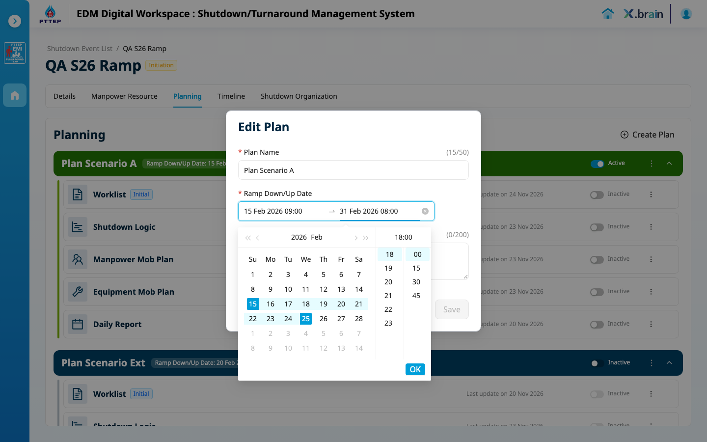
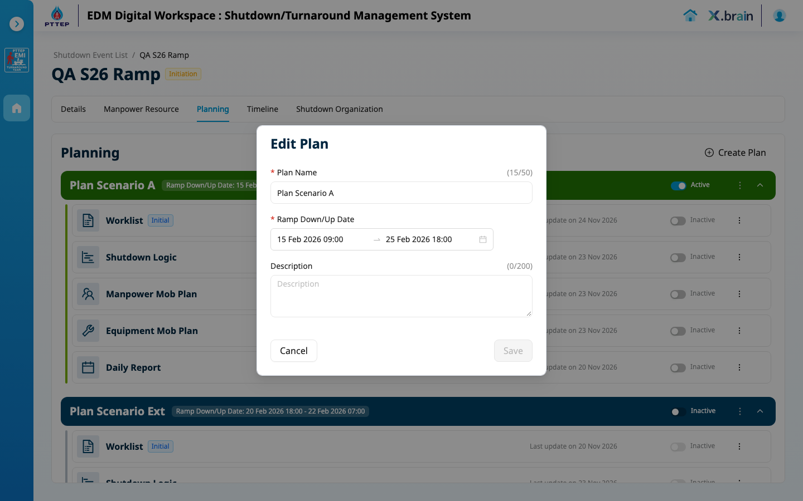
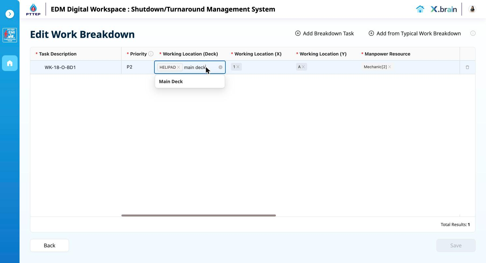
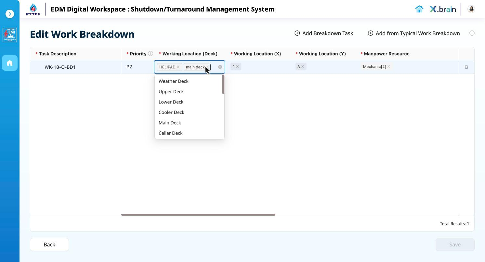
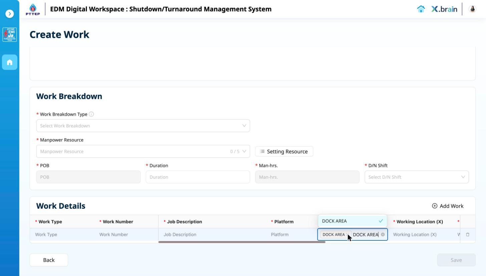
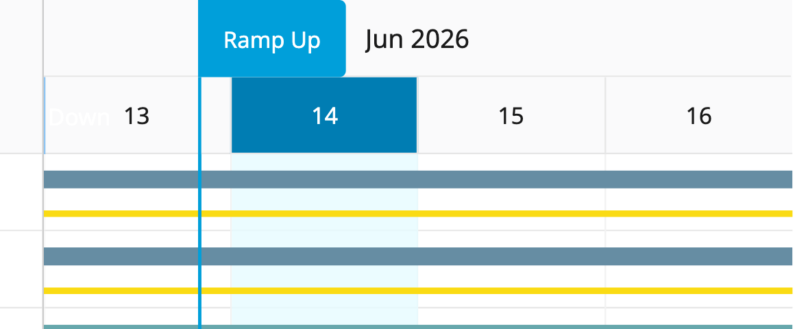
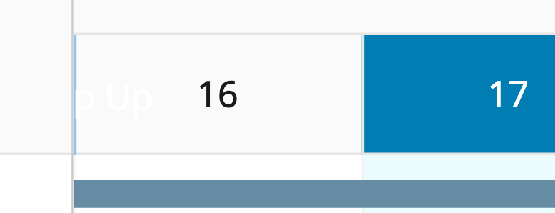
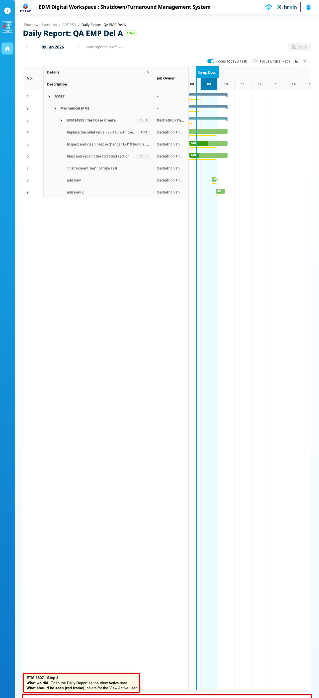

# Sprint 26 – Open questions for BA (24 Nov 2026)

All questions still waiting for an answer, for the cards In Testing. QA build of 24 Nov 2026.
⭐ = changes an Expected Result or decides whether a defect is logged. Each question says what QA does with each answer.

| Card | Questions | Pictures |
|---|---|---|
| ETM-8042 Planning – Ramp Down & Up date | Q12 | 8 |
| ETM-8049 Worklist – Working Location columns | Q33 (defect ETM-9225), Q34 | 3 |
| ETM-8392 Daily Report – Ramp lines on Gantt | R3-Q1, R3-Q2 | 2 |
| ETM-8394 Import Work status | R4-1, R4-2, R4-3, R5-1, R5-2, R5-3 (defect ETM-9233) | – |
| ETM-8521 Shutdown Logic – copy & paste | R3-1, R3-2 | – |
| ETM-7343 Daily Report – Actual (%) font color | Q5 | – |
| ETM-8003 Daily Report – S-Curve colors | R3-Q1 | 1 |
| ETM-8034 Shutdown Logic – row / cell highlight | R4-1 (Highlight Cell) | – |
| ETM-8415 Shutdown Logic – move as a block | Q1 (linked Tests) | – |

---

## ETM-8042 – Q12 ⭐ Invalid date in the Ramp Down/Up Date picker (Test ETM-8851, AC 1.2)

Where: QA, event "QA S26 Ramp" > Planning tab > Plan Card "Plan Scenario A" > three-dot > Edit Plan. Current value `15 Feb 2026 09:00 -> 25 Feb 2026 18:00`. Turnaround Manager, nothing saved.

Your answer to Q11 (24 Nov): the picker clears the invalid part and Save is disabled. On QA now:

| Case | Input | Expected (Q11 / AC 1.2) | Actual on QA |
|---|---|---|---|
| 1 | Paste `31 Feb 2026 08:00` into Start | Start cleared, Save disabled | Invalid text shown, no red border, no message, Save disabled. After leaving: Start goes back to `15 Feb 2026 09:00` (on the next click, not on Tab) |
| 2 | Paste `31 Feb 2026 08:00` into End | End cleared, Save disabled | Same; End goes back to `25 Feb 2026 18:00` on Tab |
| 3 | Paste `2026-02-08 08:00` into End | End cleared, Save disabled | Same as case 2 |
| 4 | Type `31 Feb 2026 08:00` into End | End cleared, Save disabled | Same as case 2 |

Nothing invalid is saved in any case; the difference is only "cleared" vs "previous value put back".

**Question:** Which is correct?
- (a) Clear the part and disable Save (Q11, AC 1.2): the current app is a **defect**.
- (b) Put back the previous valid value: QA updates AC 1.2 reference and ETM-8851, no defect.

Also: should Start and End behave the same? (Start puts the value back only on the next click, End already on Tab.)

| Case | a = right after the input | b = after leaving the field |
|---|---|---|
| 1 (Start) |  |  |
| 2 (End, paste) |  |  |
| 3 (End, other format) |  |  |
| 4 (End, typed) |  |  |

---

## ETM-8049 – Q33 ⭐ Old lower-case Deck value is not converted (defect ETM-9225, Test ETM-8793, TC-020)

Event NN TEST QA, Plan "QA ETM-8049 Old", work `WK-18-O`, Work Breakdown `WK-18-O-BD1` (Deck = `HELIPAD, main deck`).
- Edit Breakdown, remove the tag `main deck`, type `main deck`, press Enter: the tag stays `main deck` (lower case), although the suggestion list shows `Main Deck`.
- Typing `mAiN dEcK` on the same cell gives `Main Deck`. Only the spelling already stored on the event is not converted.

**How the data was made:** the screen now converts every new entry to the Master Data spelling, so it cannot make a lower-case `main deck` any more. QA set `main deck` directly in the QA database to stand for data saved before this change (AC 6.4: existing values are not converted, no migration). Defect ETM-9225 is already logged, so we need your answer to keep it open or close it.

**Questions:**
1. Do values that differ from Master Data only by letter case (e.g. `main deck` for `Main Deck`) really exist in production data saved before this change? (yes / no)
2. If yes: must a new entry `main deck` still convert to `Main Deck`, even when the event already holds the old value `main deck`? (AC 6.1 / 6.3 vs AC 6.4)

- 1 = yes and 2 = yes: ETM-9225 stays open.
- 1 = no: QA closes ETM-9225 as "data not reachable from UI" and removes that step from TC-020.
- 2 = no: QA closes ETM-9225 and changes the expected result of TC-020.

| Typed `main deck`, suggestion shows `Main Deck` | After Enter: stays `main deck` |
|---|---|
|  |  |

---

## ETM-8049 – Q34 ⭐ Two Deck values that differ only by letter case in one cell (Test ETM-8788, TC-015)

Create Work, one Deck cell: after the tag `Dock Area` (or `DOCK AREA`) is in the cell, typing `DOCK AREA` (or `dock area`) shows the existing tag as already selected (a tick in the list), and pressing Enter adds nothing. So one cell cannot hold two free-text values that differ only by letter case.

Your answer to Q32 says Create Work accepts several Deck values in one cell, and AC 6.2 says free text is saved exactly as entered. TC-015 expects the cell `Main Deck, Cellar Deck, Dock Area, DOCK AREA`. Import shows the same rule (`Helipad,helipad` is rejected, defect ETM-9223).

**Question:** Which is correct for Create Work and Edit Work Breakdown?
- (a) The cell may hold `Dock Area` and `DOCK AREA` together: this is a defect like ETM-9223.
- (b) Values that differ only by letter case are duplicates inside one cell: QA changes TC-015.

---

## ETM-8392 – Round 3 (AC-4 Export PDF)

Data: Event ART PSD, Plan **QA 8392 Snap C** (snapshot Ramp Down 11 Jun 2026 08:00, Ramp Up 13 Jun 2026 20:00). Export: `Daily Plan` + `Focus Timeframe` (window D-1 00:00 to D+2 23:59, DEC-061).

### R3-Q1 ⭐ Part of a Ramp badge shows in the PDF when its line is outside the Focus window (Tests ETM-8690 step 7, ETM-8692 step 4)

The lines themselves are correct in every PDF we checked. But where a line is **outside** the window, a small piece of its badge text is still drawn in the Gantt header:

| PDF (day D) | Window | Line outside | What shows |
|---|---|---|---|
| 14 Jun 2026 | 13–16 Jun | Ramp Down (11 Jun) | faint white text "Down" left of the "13" column |
| 17 Jun 2026 | 16–19 Jun | Ramp Up (13 Jun) and Ramp Down | faint white text "p Up" at the left edge of the "16" column |

The text is also in the PDF text layer (not an image artefact). On screen the badges look correct.

**Question:** When a Ramp line is outside the Focus window, should the PDF show **nothing** of that line (no line and no badge text)? If yes, QA logs a defect. If a cut badge at the edge is acceptable, QA passes these steps.

14 Jun PDF:

17 Jun PDF:

### R3-Q2 (minor) Last column and edge badge cut by the page edge

- In the Focus PDFs, the last day column (D+2) is cut by the right page edge.
- In the 11 Jun PDF (window 10–13 Jun) the Ramp Up line on 13 Jun (last day, inside per DEC-061) is drawn, but its badge shows only "R".

**Question:** Is it acceptable that the D+2 column and a badge on that day are partly cut, or should the whole D+2 day and its badge fit on the page?

---

## ETM-8394 – Round 4 (Import Work Status / Breakdown Status)

19 Tests: 13 passed, 4 failed, 2 not run (need a frozen Worklist). Two failures depend on your answer.

### R4-1 ⭐ A breakdown UUID from a deleted Work, used under another Work (Test ETM-8766)

Setup: Work `Y1` (2 breakdowns) and Work `Y2` (1 breakdown). `Y1` is deleted through import (`Action = Delete`).
File: `Y2` Work row with `Action = Revise`, plus one `Work Breakdown` row under `Y2` with `Action = Revise` and the UUID of a breakdown of the deleted `Y1`.
- **App shows:** "The work breakdown with the entered UUID is already associated with another work in the system." `Import` is disabled.
- **Test expects:** "The UUID you entered is not exist in the system." (AC 3.4), because the breakdown was deleted with `Y1`.

**Question:** Which message is correct? The row is rejected in both cases; only the message differs.
QA assumes AC 3.4 wins. If "already associated" is accepted, QA changes ETM-8766 and logs no defect.

### R4-2 ⭐ Delete a Work and its breakdowns in one file (Test ETM-8767)

File: `Z2` Work row with `Action = Delete` and one `Work Breakdown` row of `Z2` with `Action = Delete`. Import is accepted and confirmed.
- **Result:** Work `Z2` is soft deleted (gone from the Worklist). Its breakdown row is still in the database with no delete flag.
- **Template rules say:** deleting a Work is a soft delete together with its breakdowns.

**Question:** Should the breakdowns of a deleted Work also be marked deleted, or is it enough that the parent Work is deleted?
QA assumes they must be marked deleted too (then QA logs a defect). If not, QA changes ETM-8767 to check only that the Work is deleted and its breakdowns no longer show.

### R4-3 (no answer needed if R4-2 is "defect")

With the breakdown still in the database, a later Revise with its UUID could give the "already associated" message of R4-1 instead of "not exist". R4-1 and R4-2 may have the same cause.

### Round 5 – defect ETM-9233 "Exported Worklist cannot be imported back unchanged" (Test ETM-8755)

On QA (Worklist "Wide Plan B - NN", Turnaround Manager):
- `Export Worklist` gives a file whose sheet `Worklist_Data` has the `Action` column (C) blank on all 306 data rows (84 Work, 222 Work Breakdown). `UUID` is filled.
- Uploading that file unchanged gives "Data Validation Failed. 308 data validation errors were found in the file." Every row shows "This field is mandatory." on `Action`. `Confirm` is disabled.
- The file holds the whole Worklist, even when the list on screen was filtered with the search box.

**R5-1 ⭐ What should `Action` be in an exported file?** AC 4 says "export then import again keeps each Work's status". Today that is not possible without editing the file.
- (a) The export fills `Action = Revise` on every row.
- (b) The export leaves `Action` blank, and the import treats a blank `Action` on a row **with a UUID** as `Revise`.
- (c) Blank is correct and the user must fill `Action` first; AC 4 then needs a note.

QA assumes (a) or (b), so ETM-9233 stays a defect. If (c), QA closes ETM-9233 as "not a defect" and changes ETM-8755 step 3.

**R5-2 ⭐ Should the export follow the Worklist search / column filters?** Today it ignores them. QA assumes the whole Worklist is correct (not a defect). If it must follow the filter, please say which filters count.

**R5-3 (only if R5-1 is (b))** An unchanged row then imports with no error and no change, and `Updated By` / `Updated Date` do not change. Please confirm.

---

## ETM-8521 – Round 3 (copy & paste in the Gantt table)

Turnaround Manager account.

### R3-1 ⭐ Copy of two cells that are not next to each other (Test ETM-8737, steps 6–7)

1. Selected the Description cell of row 1, then Ctrl+click on the Duration cell of row 2 (not next to each other; both show as selected).
2. Ctrl+C.
3. Clicked the Description cell of another row and Ctrl+V.

- **App:** the clipboard holds the two values in **one column** (`Pump overhaul A`, then `12`). After paste, target row 1 Description = `Pump overhaul A` (OK), but `12` goes to the **Description of target row 2**; Duration of row 2 is not changed.
- **Test expects:** the layout is kept: row 1 Description = `Pump overhaul A`, row 2 Duration = `12`, the two skipped cells stay blank.

**Question:** Which is correct?
- (a) Layout must be kept: current behaviour is a defect.
- (b) Non-adjacent cells are packed into one column: QA changes step 7 of ETM-8737.
- (c) Copying non-adjacent cells is not supported: QA removes steps 6–7.

### R3-2 ⭐ Finish-to-Start after pasting a new Start date (Test ETM-8743, step 6)

Task B depends on task A (Finish to Start, no lag), same Work. Pasted a new Start date (A's Start + 1 day) into A.
- Before (step 5): A ends `02 Jun 2026, 20:15`, B starts `02 Jun 2026, 20:15`.
- After (step 6): A ends `03 Jun 2026, 19:45`, B starts `03 Jun 2026, 20:00`.
- B's calendar has working time between 19:45 and 20:00, so B could start at 19:45.

**Question:** Should B start exactly when A ends (19:45)?
- (a) Yes: the 15-minute gap is a defect.
- (b) No: the gap is expected (please give the rule: rounding, a constraint kept on B, a shift start…); QA changes the Expected Result of step 6.

---

## ETM-7343 – Q5 ⭐ Job Owner on a new Event's Active Plan (Test ETM-8678)

On QA, the Job Owner test account opens the Daily Report of the Active Plan "QA ETM-7343 Colors" (Event "QA ETM-7343", the only Plan, Active) and gets "Access Denied: If you need access to the Application, please send a request with your details." The Turnaround Manager opens the same page fine.

**Questions:**
- Must a Job Owner be added to the Event (organization / member) or be the Job Owner of a work in the Plan before they can see its Active Daily Report?
- If yes, how is that done on the screen, so QA can set it up?
- If no, the Job Owner should see the table, and this is a defect.

---

## ETM-8003 – R3-Q1 ⭐ S-Curve filter button is disabled for the Job Owner (Tests ETM-8808, ETM-8809)

- The user is the Job Owner (permission "View Active Daily Report Item"), on the Daily Report of an Active plan: Event ART PSD, Plan "QA EMP Del A".
- The S-Curve – Cumulative Progress card shows the chart with the correct colors (Plan blue #1677FF, Actual orange #FA8C16), the same as for the Turnaround Manager.
- The filter button at the top of the S-Curve card is **disabled**, so the Job Owner cannot open the Filter Panel to change Scale (Day / Week / Month), Show Plan(%) or Show Actual(%) (Show All / Show Only Today).
- The Turnaround Manager ("View All Daily Report Item") has the same button enabled on the same page.

**Question:** Is the S-Curve filter meant to be disabled for a view-only user (Job Owner)?
- **Yes:** expected behaviour; ETM-8808 / ETM-8809 are tested with the Turnaround Manager only.
- **No:** the Job Owner should be able to use the Filter Panel (it only changes the view and saves nothing). QA logs a defect against the Story that owns the S-Curve filter (ETM-4127?). Please confirm which Story that is.

---

## ETM-8034 – R4-1 ⭐ Highlight Cell is not in the AC

AC 1.2 (edited 24 Nov 14:23) now says No Color + 12 colours (13 options): this matches ETM-8856 and the script. Thank you.

The build of 24 Nov and the behaviour table the team shared say: a right-click on a cell (no row selected) shows **Highlight Cell** and colours only the selected cell(s); **Highlight Row** shows only after a double-click on the No. cell selects the whole row. Shift + Click / Shift + Double Click select several cells / rows. AC 1.1 still says "Right-clicking a row ... Highlight Row", and AC 2 / AC 3 speak of the whole row only.

**Please add to AC 1.1, AC 2 and AC 3:**
- (a) how to select a row (double-click No.);
- (b) Highlight Cell / Change Text Color on one or several cells;
- (c) whether a cell colour is saved, undone, duplicated, copied and exported like a row colour;
- (d) the Delete option in this menu (is it the existing Delete Work / Delete Work Breakdown?).

Until then QA tests Highlight Row through a selected row, and has no Test for Highlight Cell.

---

## ETM-8415 – Q1 ⭐ The 263 linked Tests do not test this Story

ETM-8415 ("Work Header and Work Dependencies move as a block") has 263 Tests linked with "is tested by" (ETM-8945 to ETM-9217), all created on 24 Nov 2026 16:07–17:01 in one bulk import, all Open.
- They are a whole-page Shutdown Logic regression suite: page load, URL, JO view-only, cell edit, Start Date, drag/resize, Manual Adjust, hard-link drag, red cells, save blocking. 263 unique titles, no duplicates.
- **None** of them is about this Story: Work Header as Predecessor/Successor, moving as a block, Block Start/End, nested blocks, a constraint on a block. AC 1–12 of ETM-8415 have no Test.
- The suite fits ETM-8905 ("Shutdown Logic – code restructuring, no behavior change", AC 4: full regression) much better. ETM-8905 has no Tests linked.

**Questions:**
1. Were these 263 Tests meant for ETM-8905 (regression after the refactor) rather than ETM-8415? If yes, QA will move the links to ETM-8905 (with your OK) and run them there.
2. For ETM-8415, may QA write its own Tests from AC 1–12 (block move), or is there another set planned?

---

Thank you.
